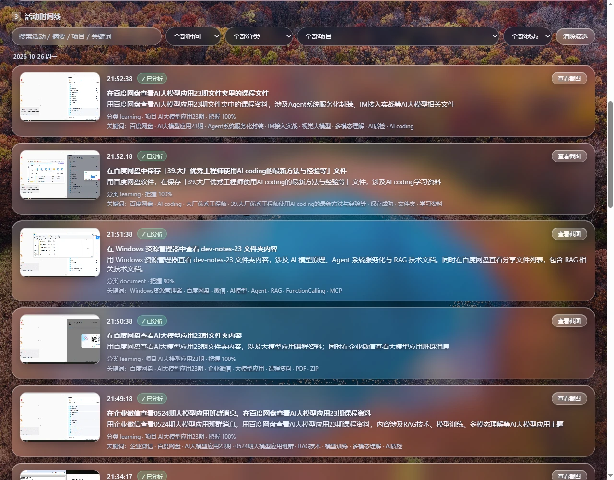
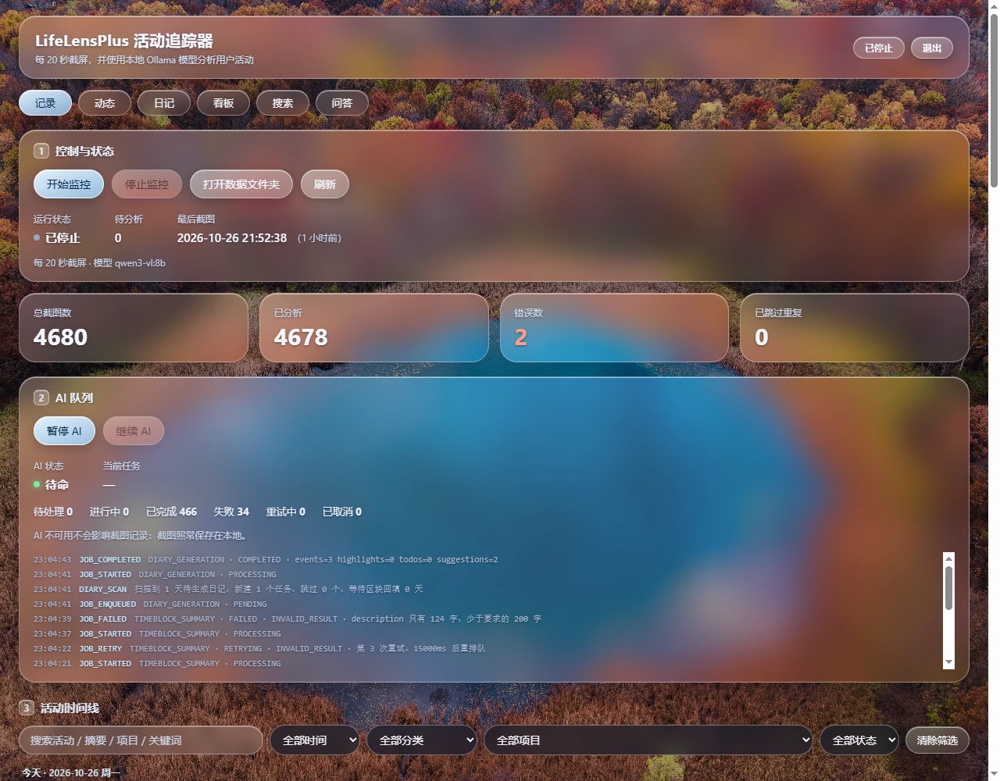
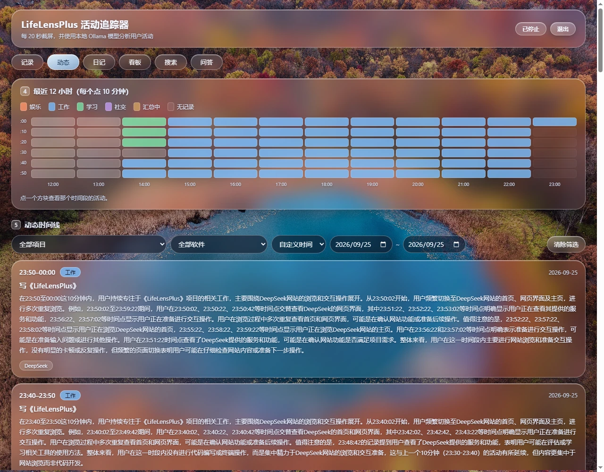
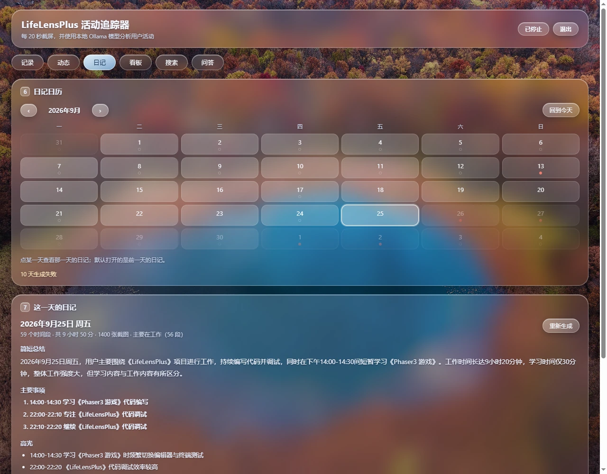
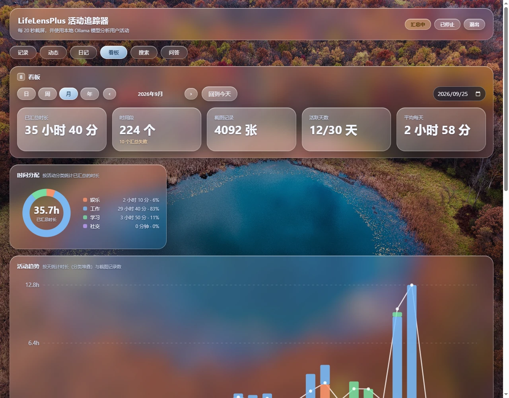
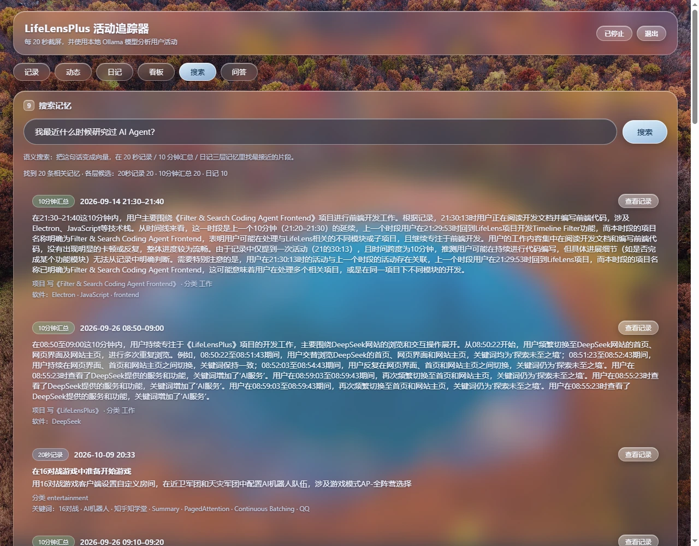
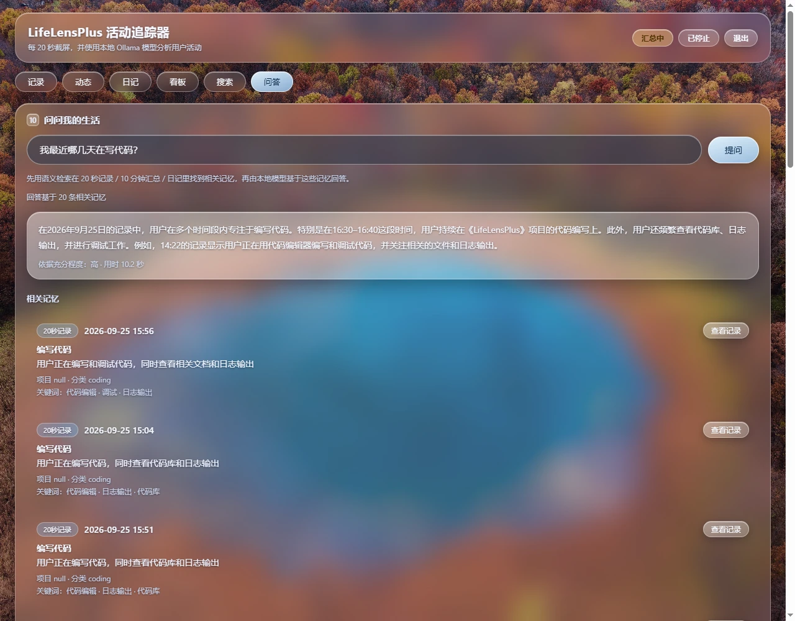
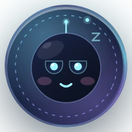
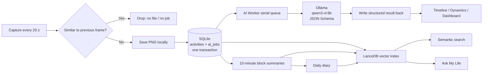

<div align="center">

# LifeLensPlus

**Turn a screenshot every 20 seconds into memories you can revisit, search, and ask about — with a local AI.**

No manual journaling. No cloud account. Nothing leaves your machine.

[中文](README.md) · [English](README.en.md) · [Français](README.fr.md)


</div>



## What is this?

LifeLensPlus is a fully local desktop **life recorder**. It captures your screen at a fixed interval, has a local Ollama vision model describe what you are doing, and turns those fragments into an activity timeline, 10-minute summaries, daily diaries, statistics dashboards, and a semantic memory you can search and ask questions about.

It solves a very concrete problem: **you do a lot in a day, but by the evening all you remember is "I was busy."** Manual journaling rarely survives a week; LifeLensPlus records the process while you work, so the evening review is just reading and asking.

What it deliberately does **not** do:

- **Not surveillance software**: no cloud backend, no admin dashboard, no keylogging, no window-title collection.
- **No uploads**: screenshots, databases and vector indexes stay on your machine; the models run locally too.
- **No interruptions**: capturing only saves a PNG and enqueues a job. AI analysis runs in a background queue. If Ollama is down, recording continues.

> The data directory lives under your Pictures folder by default and is entirely yours. Deleting the vector index does not touch the original records — it can be rebuilt at any time.

## Contents

- [Features](#features)
- [Screenshots](#screenshots)
- [How it works](#how-it-works)
- [Tech stack](#tech-stack)
- [Quick start](#quick-start)
- [Configuration](#configuration)
- [Where the data lives](#where-the-data-lives)
- [Project layout](#project-layout)
- [Tests](#tests)
- [Known limitations](#known-limitations)
- [Documentation](#documentation)
- [License](#license)

## Features

| Capability | Description |
| --- | --- |
| **Automatic capture** | Captures the primary display every 20 seconds by default; near-identical frames are discarded before they are saved or queued |
| **Local AI analysis** | Ollama + `qwen3-vl:8b` with JSON Schema–constrained structured output: activity, summary, category, project, keywords, confidence |
| **Activity timeline** | Grouped by day, with keyword, time-range, category, project and analysis-status filters and pagination |
| **10-minute dynamics** | Summarizes several captures into "what was happening in this stretch", with project, software and possible todos |
| **Daily diary** | A second-order summary at the end of each day: summary, main events, highlights, todos, suggestions and tips |
| **Dashboard** | Day / week / month / year views: time allocation, activity trend, hourly distribution, project focus, software usage and keywords |
| **Semantic search** | Ask in natural language and search three layers of memory: 20-second captures, 10-minute blocks, and diaries — with local `bge-m3` embeddings and LanceDB |
| **Ask My Life** | Retrieves relevant memories first, then asks a local model to answer using only those memories and lists its sources |
| **Floating launcher** | A 56×56 desktop orb ("Xiaojing") that opens the app, pauses/resumes recording, quits, and reacts to capture and analysis events with facial expressions |

## Screenshots

> Taken from a real local run — not mockups.

### 1. Recording: captures and local AI analysis

Each capture is analyzed in the background into structured fields. The AI queue and the capture loop are fully decoupled: slow inference, model errors or a backlog never stop recording.



### 2. Activity timeline: how the day actually went

The timeline keeps the screenshot thumbnail, activity description, category, project and keywords. You can search for "AI Agent", or filter by project and category to revisit a specific stretch of time.


### 3. Dynamics: 10-minute slices of "what was just happening"

The heatmap colors the last 12 hours by work / study / entertainment / social. Below it, 10-minute block cards describe the project, software and possible loose ends.



### 4. Diary: the day written up automatically

Dots on the calendar show which days have records and which have generated diaries. Open a day to read its summary, main events, highlights, todos and suggestions.



### 5. Dashboard: time turned into numbers you can compare

Day / week / month / year periods with total summarized time, number of blocks, screenshots, active days, and charts for time allocation, activity trend, hourly distribution, project focus, software usage and keywords.



### 6. Search: find the past with one sentence

"When did I last look into AI agents?" — the question is embedded locally and matched against 20-second captures, 10-minute blocks and diaries. Every result links back to the original record.



### 7. Ask My Life: ask questions about your own history

The same retrieval pipeline feeds a compact context to the local model, which answers with a confidence level and a list of supporting memories. It is instructed to answer only from retrieved records.



### 8. Floating launcher: Xiaojing on your desktop

A 56×56 always-on-top orb. It breathes while recording, dims when paused, and flashes through expressions when a capture is taken or an analysis finishes. Closing the main window only hides it; background recording continues.

<p align="center">
  
</p>

## How it works



Key design choices:

- **Capture and AI are decoupled**: the capture loop only saves a PNG, writes a record and enqueues a job — milliseconds. A resident worker runs inference serially.
- **One transaction**: `activities` and `ai_jobs` are written in the same SQLite transaction. If it fails, the just-written PNG is removed, so there is no "image without a record" orphan.
- **Structured output**: categories, projects and keywords are not requested by prompt text. Ollama's native `format` + JSON Schema constrains decoding, and the app validates the business rules again.
- **Catch up after downtime**: unfinished jobs are recovered on startup; missing block summaries and diaries are scanned and regenerated.
- **Three memory layers**: captures, blocks and diaries each get their own vector table. SQLite remains the source of truth; LanceDB is a rebuildable index.

## Tech stack

- **Desktop**: Electron 44, plain HTML / CSS / JavaScript — no frontend framework, no build step
- **Storage**: Node's built-in `node:sqlite` (WAL) plus the filesystem; no ORM
- **AI**: local Ollama inference; `qwen3-vl:8b` for vision, `bge-m3` for embeddings
- **Vector index**: `@lancedb/lancedb`, three tables; safe to delete and rebuild
- **UI**: hand-written SVG charts, glassmorphism styling, no external UI library
- **Tests**: Node's built-in `node --test`; Ollama is fully mocked, no GPU required

## Quick start

### 1. Requirements

- Node.js **22.5+** (`node:sqlite` is available from 22.5; developed on 22.23.2)
- [Ollama](https://ollama.com/) installed
- Disk space for models: `qwen3-vl:8b` is about 6 GB, `bge-m3` about 1.2 GB

### 2. Pull the models and start Ollama

```bash
ollama pull qwen3-vl:8b
ollama pull bge-m3
ollama serve   # listens on http://127.0.0.1:11434
```

### 3. Install and run

```bash
npm install
npm start
```

If `npm start` reports that Electron is incomplete (the binary was not downloaded during install):

```bash
node node_modules/electron/install.js
```

### 4. System permissions

- **Windows**: no extra setup
- **macOS**: allow screen recording in System Settings → Privacy & Security → Screen Recording
- **Linux**: X11 or the PipeWire desktop portal

Recording starts automatically on first launch. Pause or resume from the window header, or from the floating launcher's context menu.

## Configuration

Everything is configured through environment variables. The common ones:

| Variable | Default | Description |
| --- | --- | --- |
| `LIFELENS_DIR` | `Pictures/LifeLensPlus` | Data directory: database + screenshots |
| `LIFELENS_INTERVAL_MS` | `20000` | Capture interval in milliseconds |
| `LIFELENS_MODEL` | `qwen3-vl:8b` | Vision model |
| `LIFELENS_OLLAMA_HOST` | `http://127.0.0.1:11434` | Ollama endpoint |
| `LIFELENS_AUTOSTART` | `1` | Set to `0` to start without recording |
| `LIFELENS_AI_CONCURRENCY` | `1` | AI worker concurrency (keep at 1 for 8B models) |
| `LIFELENS_AI_MAX_RETRIES` | `3` | Maximum retries after a failure |
| `LIFELENS_NUM_CTX` | `16384` | Ollama context length; screenshots are sent at native resolution, so 4K screens need enough context |
| `LIFELENS_EMBEDDING_MODEL` | `bge-m3` | Local embedding model |
| `LIFELENS_SUMMARY_MODEL` | same as `LIFELENS_MODEL` | Text model for block summaries and Q&A |

The full list (timeouts, retry backoff, scan intervals, embedding batch sizes, etc.) is in [docs/07-配置与运行.md](docs/07-配置与运行.md) (Chinese).

## Where the data lives

| Data | Location |
| --- | --- |
| Activity records, AI job queue | `<LIFELENS_DIR>/lifelens.db` (SQLite, WAL) |
| Screenshots | `<LIFELENS_DIR>/<YYYY-MM>/images/<YYYY-MM-DD_HH-mm-ss-SSS>.png` |
| Vector index | `lancedb/` under Electron's userData directory; safe to delete and rebuild |
| Launcher position | `launcher-position.json` under Electron's userData directory |

`lifelens.db` contains structured text metadata only; screenshot content lives in separate PNG files. Deleting one screenshot does not affect the rest of its record. The database is not encrypted — treat the data directory like any other personal file.

## Project layout

```text
LifeLensPlus/
├── src/
│   ├── main/                 Electron main process
│   │   ├── main.js           windows, IPC, startup and shutdown order
│   │   ├── recorder.js       capture loop, persistence, result write-back
│   │   ├── capture.js        screen capture and pre-model sizing
│   │   ├── ai/               queue, worker, providers, structured output
│   │   ├── db/               SQLite connection, migrations, repositories
│   │   ├── summary/          10-minute block summaries
│   │   ├── diary/            daily diary generation
│   │   ├── embedding/        embedding service and LanceDB storage
│   │   ├── search/           semantic retrieval across three memory layers
│   │   ├── ask/              Q&A orchestration
│   │   ├── stats/            dashboard aggregation
│   │   └── launcher/         floating launcher window and position
│   ├── preload.js            main-window IPC bridge
│   ├── launcherPreload.js    launcher IPC bridge
│   └── renderer/             timeline / dynamics / diary / dashboard / search / ask UI
├── test/                     node --test suites
├── docs/                     topic-based project documentation
└── screenshots/              README screenshots
```

## Tests

```bash
npm test
```

**All 344 tests pass.** Coverage includes the AI queue state machine and retries, structured-output validation, SQLite storage and transactions, timeline queries, block summaries, diaries, the dashboard, embeddings and LanceDB, search, Q&A, and the floating launcher.

Ollama is fully mocked — no model or GPU is required. LanceDB uses real local files in temporary directories that are closed and removed after each suite.

## Known limitations

- Captures the primary display only; other monitors are ignored.
- The interval is fixed (20 s by default). Near-identical frames are dropped, but the cadence does not react to system events such as app switches or screen lock.
- AI concurrency defaults to 1 to avoid fighting an 8B model for VRAM; analysis may land a little later than the capture.
- Structured-output reliability depends on the Ollama version and model combination. On some versions, `qwen3-vl` thinking text can collide with JSON output — see [docs/37-截图分析性能.md](docs/37-截图分析性能.md) and [docs/39-截图分辨率与识别准确度.md](docs/39-截图分辨率与识别准确度.md) (Chinese).
- Screenshots up to 4K are sent at native resolution. If you set `LIFELENS_NUM_CTX=0`, Ollama's default 4096 context may not fit a 4K screenshot.
- The database is not encrypted and there is no cloud sync or multi-device support; all data is local.
- Closing the main window hides it; recording and AI keep running. To quit completely, use the launcher's context menu or the "Quit" button.
- `project` is filled only when the screenshot contains clear evidence (title bar, file name, page title); most captures are `null`. `confidence` is the model's self-assessment, not a calibrated probability.
- The similar-frame threshold (32×18 grayscale grid, mean absolute difference ≤ 8) was tuned on one machine; a different display or usage pattern may need adjustment.
- The UI and most documentation are currently Chinese-only; there is no i18n yet.

## Documentation

Detailed, topic-based documentation lives in [docs/](docs/README.md) (Chinese):

| Topic | Entry |
| --- | --- |
| Architecture and data flow | [01-架构总览](docs/01-架构总览.md), [04-数据流与事务](docs/04-数据流与事务.md) |
| Database and migrations | [02-数据库设计](docs/02-数据库设计.md), [03-迁移与版本](docs/03-迁移与版本.md) |
| AI queue and structured output | [05-AI任务队列](docs/05-AI任务队列.md) |
| Timeline / dynamics / diary / dashboard | [11-Timeline界面](docs/11-Timeline界面.md), [15-时间区块汇总](docs/15-时间区块汇总.md), [18-日记生成](docs/18-日记生成.md), [20-看板与统计](docs/20-看板与统计.md) |
| Memory index / search / Q&A | [22-记忆索引](docs/22-记忆索引-embedding与LanceDB.md), [24-记忆搜索](docs/24-记忆搜索.md), [26-问答AskMyLife](docs/26-问答AskMyLife.md) |
| Launcher and Xiaojing | [28-悬浮入口](docs/28-悬浮入口.md), [32-小镜表情动画](docs/32-小镜表情动画.md) |
| Performance and capture quality | [37-截图分析性能](docs/37-截图分析性能.md), [38-相似帧过滤](docs/38-相似帧过滤.md), [39-截图分辨率与识别准确度](docs/39-截图分辨率与识别准确度.md) |
| Testing and verification | [06-测试与验证](docs/06-测试与验证.md) |

## Contributing

Issues, discussions and pull requests are welcome. Before submitting code, please run `npm test` and try to preserve the existing boundaries:

- SQL belongs in `src/main/db/` only.
- The renderer accesses data only through the preload IPC bridge.
- Providers own model calls and schemas; the queue and worker do not know prompt fields.
- Update the matching document in `docs/` when you add a feature.

## License

[MIT](LICENSE) © 2026 LifeLensPlus contributors
