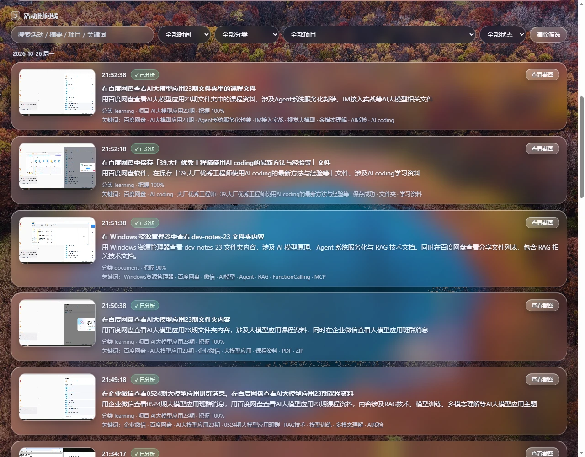
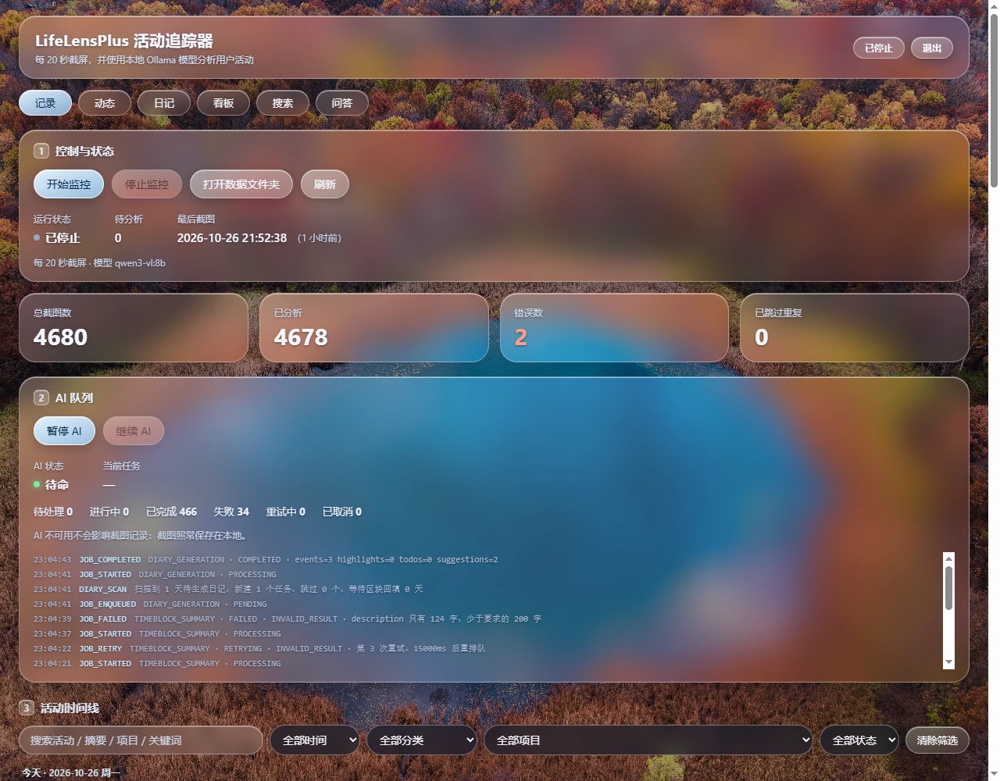
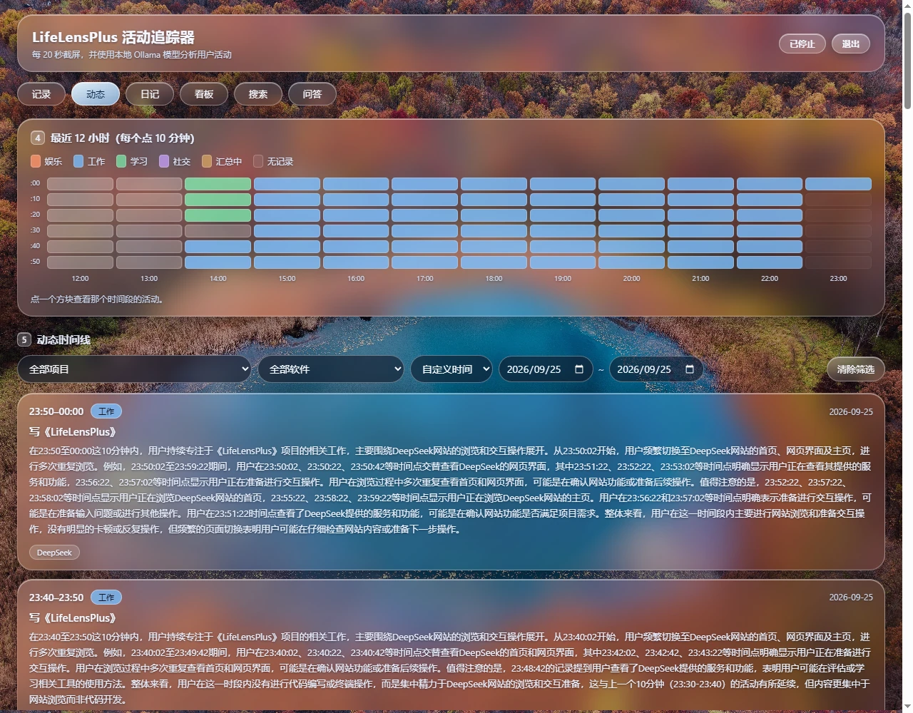
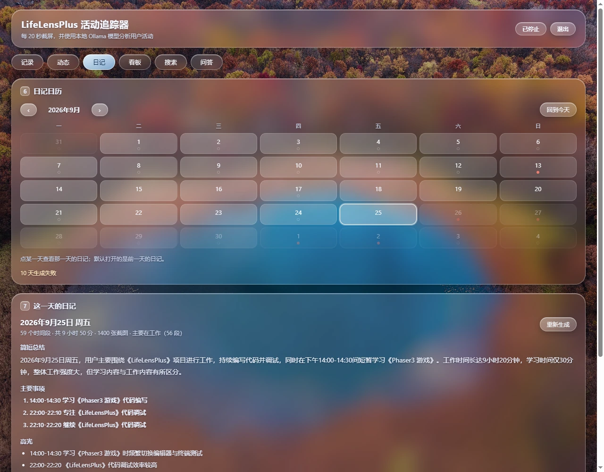
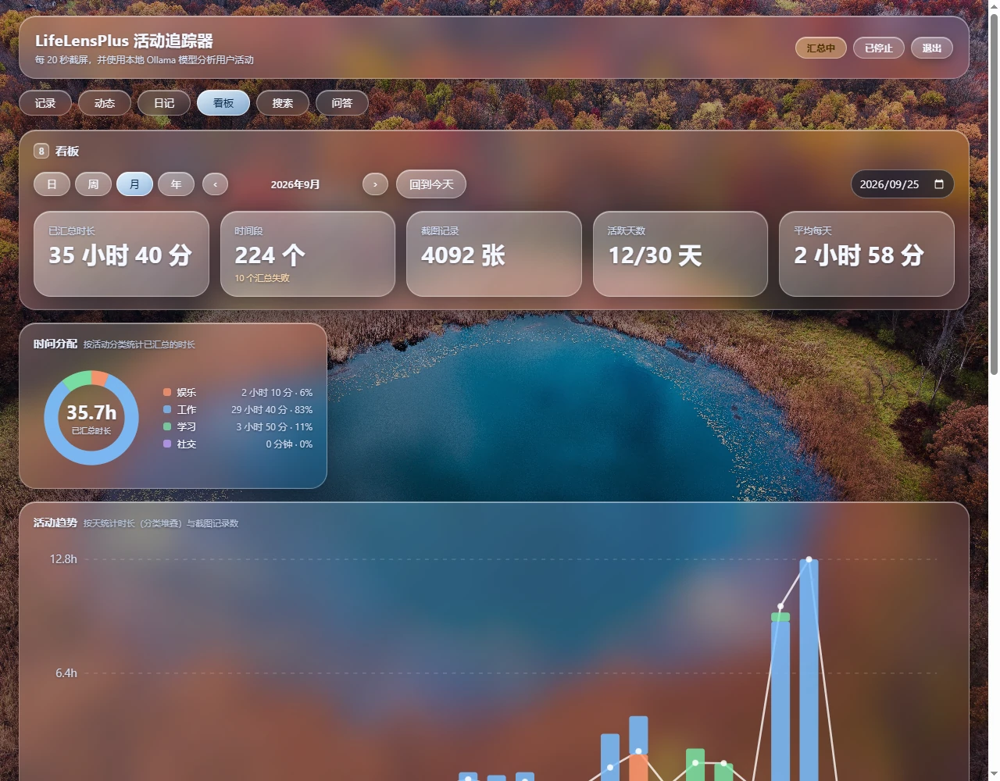
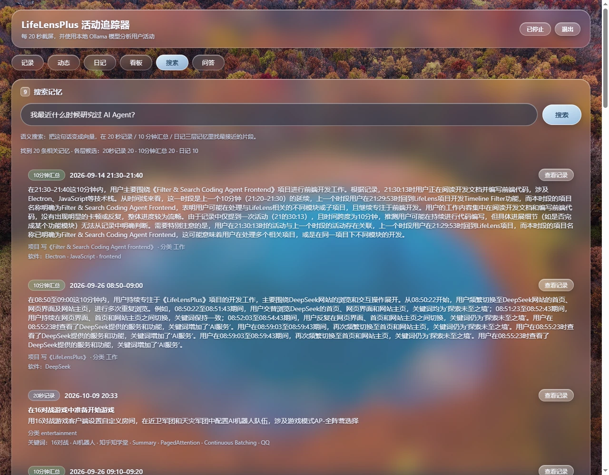
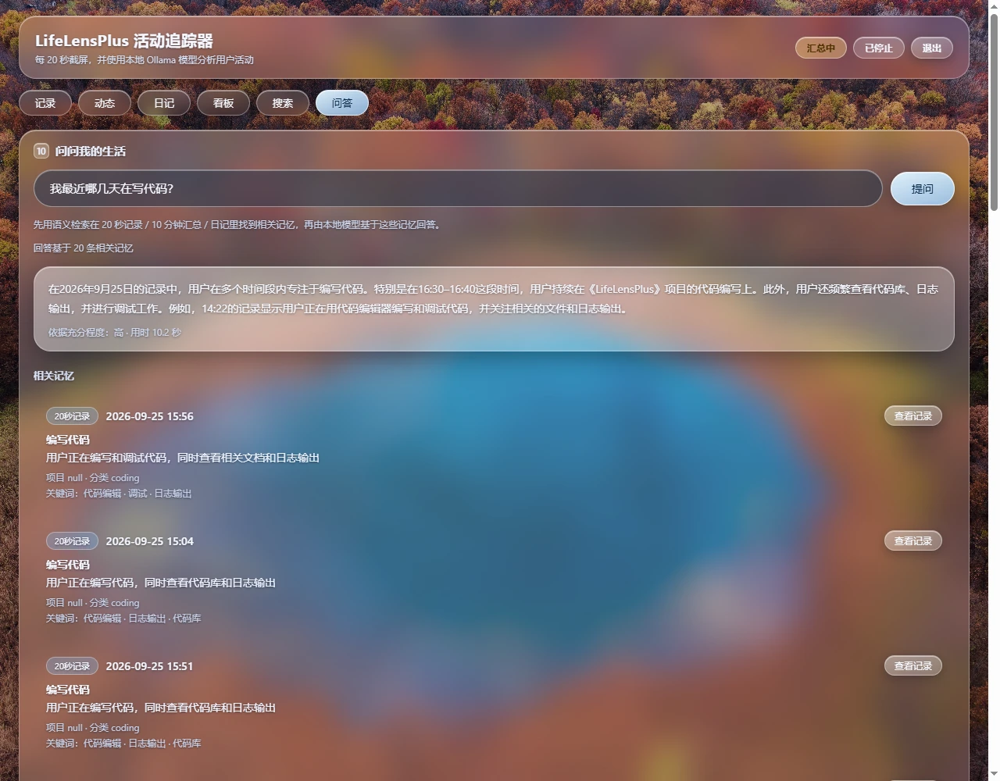
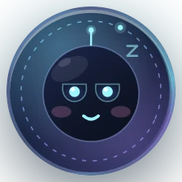
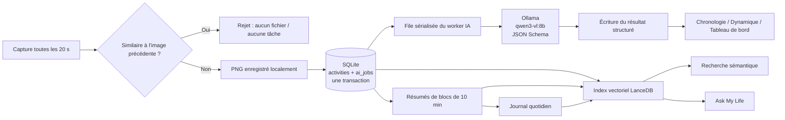

<div align="center">

# LifeLensPlus

**Une capture d'écran toutes les 20 secondes ; l'IA locale transforme le déroulement de la journée en souvenirs que l'on peut revivre.**

Pas de prise de notes manuelle. Aucune donnée envoyée. Aucun compte cloud.

[中文](README.md) · [English](README.en.md) · [Français](README.fr.md)


</div>



## Qu'est-ce que c'est ?

LifeLensPlus est un **enregistreur de vie** de bureau entièrement local : il capture l'écran à intervalle fixe, fait décrire ce que vous faites par un modèle de vision Ollama exécuté sur la machine, puis transforme ces fragments en chronologie d'activité, résumés de 10 minutes, journaux quotidiens, tableaux de bord et mémoire sémantique interrogeable.

Il répond à un problème très concret : **vous faites beaucoup de choses dans une journée, mais le soir il ne reste que « j'ai eu l'impression d'être occupé ».** Tenir un journal manuel dépasse rarement une semaine ; LifeLensPlus enregistre le déroulement pendant que vous travaillez, et la relecture du soir se limite à lire et à poser des questions.

Ce qu'il ne fait délibérément **pas** :

- **Pas un logiciel de surveillance** : pas de backend cloud, pas de tableau de bord administrateur, pas de keylogger, pas de collecte des titres de fenêtres.
- **Aucun envoi de données** : captures, base de données et index vectoriels restent sur votre machine ; les modèles tournent aussi en local.
- **Aucune interruption** : la capture ne fait qu'enregistrer un PNG et mettre une tâche en file. L'analyse IA s'exécute dans une file d'attente en arrière-plan. Même si Ollama est arrêté, l'enregistrement continue.

> Le répertoire de données se trouve par défaut dans votre dossier Images et vous appartient entièrement. Supprimer l'index vectoriel ne touche pas aux enregistrements d'origine : il peut être reconstruit à tout moment.

## Sommaire

- [Fonctionnalités](#fonctionnalités)
- [Captures d'écran](#captures-décran)
- [Comment ça marche](#comment-ça-marche)
- [Stack technique](#stack-technique)
- [Démarrage rapide](#démarrage-rapide)
- [Configuration](#configuration)
- [Où sont stockées les données](#où-sont-stockées-les-données)
- [Structure du projet](#structure-du-projet)
- [Tests](#tests)
- [Limites connues](#limites-connues)
- [Documentation](#documentation)
- [Licence](#licence)

## Fonctionnalités

| Capacité | Description |
| --- | --- |
| **Capture automatique** | Capture l'écran principal toutes les 20 secondes par défaut ; les images quasi identiques sont écartées avant d'être enregistrées ou mises en file |
| **Analyse IA locale** | Ollama + `qwen3-vl:8b` avec sortie structurée contrainte par JSON Schema : activité, résumé, catégorie, projet, mots-clés, confiance |
| **Chronologie d'activité** | Regroupée par jour, avec des filtres par mot-clé, plage horaire, catégorie, projet et statut d'analyse, ainsi que la pagination |
| **Dynamique par 10 minutes** | Résume plusieurs captures en « ce qui se passait pendant ce créneau », avec projet, logiciels et pistes de tâches |
| **Journal quotidien** | Un résumé de second niveau en fin de journée : synthèse, événements principaux, points forts, tâches à faire, suggestions et conseils |
| **Tableau de bord** | Vues jour / semaine / mois / année : répartition du temps, tendance d'activité, répartition horaire, focus par projet, usage des logiciels et mots-clés |
| **Recherche sémantique** | Posez une question en langage naturel et explorez trois couches de mémoire : captures de 20 secondes, blocs de 10 minutes et journaux — avec des embeddings `bge-m3` locaux et LanceDB |
| **Ask My Life** | Récupère d'abord les souvenirs pertinents, puis demande à un modèle local de répondre uniquement à partir de ces souvenirs et d'en lister les sources |
| **Lanceur flottant** | Un orbe de 56×56 sur le bureau (« Xiaojing ») qui ouvre l'application, met en pause / reprend l'enregistrement, quitte, et réagit aux captures et analyses par des expressions faciales |

## Captures d'écran

> Issues d'une exécution locale réelle — pas des maquettes.

### 1. Enregistrement : captures et analyse IA locale

Chaque capture est analysée en arrière-plan pour en extraire des champs structurés. La file d'analyse et la boucle de capture sont totalement découplées : une inférence lente, une erreur du modèle ou un arriéré ne stoppent jamais l'enregistrement.



### 2. Chronologie d'activité : comment la journée s'est réellement passée

La chronologie conserve la vignette de la capture, la description de l'activité, la catégorie, le projet et les mots-clés. Vous pouvez rechercher « AI Agent », ou filtrer par projet et catégorie pour revoir un créneau précis.


### 3. Dynamique : des tranches de 10 minutes de « ce qui venait de se passer »

La carte de chaleur colore les 12 dernières heures par travail / étude / divertissement / social. En dessous, les cartes de blocs de 10 minutes décrivent le projet, les logiciels et les éventuelles tâches en suspens.



### 4. Journal : la journée rédigée automatiquement

Les points du calendrier indiquent les jours avec des enregistrements et ceux avec un journal généré. Ouvrez un jour pour lire sa synthèse, ses événements principaux, ses points forts, ses tâches et ses suggestions.



### 5. Tableau de bord : le temps transformé en chiffres comparables

Périodes jour / semaine / mois / année avec le temps total résumé, le nombre de blocs, les captures, les jours actifs, et des graphiques de répartition du temps, tendance d'activité, répartition horaire, focus par projet, usage des logiciels et mots-clés.



### 6. Recherche : retrouver le passé en une phrase

« Quand ai-je étudié les agents IA pour la dernière fois ? » — la question est transformée localement en vecteur et comparée aux captures de 20 secondes, aux blocs de 10 minutes et aux journaux. Chaque résultat renvoie à l'enregistrement d'origine.



### 7. Ask My Life : posez des questions sur votre propre historique

Le même pipeline de récupération alimente un contexte compact fourni au modèle local, qui répond avec un niveau de confiance et une liste de souvenirs justificatifs. Il est instruit de ne répondre qu'à partir des enregistrements récupérés.



### 8. Lanceur flottant : Xiaojing sur votre bureau

Un orbe 56×56 toujours au premier plan. Il respire pendant l'enregistrement, s'assombrit en pause et affiche des expressions fugaces lors d'une capture ou à la fin d'une analyse. Fermer la fenêtre principale ne fait que la masquer ; l'enregistrement continue.

<p align="center">
  
</p>

## Comment ça marche



Quelques choix de conception clés :

- **Capture et IA découplées** : la boucle de capture ne fait qu'enregistrer un PNG, écrire un enregistrement et mettre une tâche en file — quelques millisecondes. Un worker résident exécute l'inférence en série.
- **Une seule transaction** : `activities` et `ai_jobs` sont écrits dans la même transaction SQLite. En cas d'échec, le PNG tout juste écrit est supprimé : aucun orphelin « image sans enregistrement ».
- **Sortie structurée** : les catégories, projets et mots-clés ne sont pas obtenus par du texte de prompt. Le `format` natif d'Ollama + JSON Schema contraint le décodage, et l'application revalide ensuite les règles métier.
- **Rattrapage après une interruption** : les tâches inachevées sont récupérées au démarrage ; les résumés de blocs et journaux manquants sont scannés et régénérés.
- **Trois couches de mémoire** : captures, blocs et journaux ont chacun leur table vectorielle. SQLite reste la source de vérité ; LanceDB n'est qu'un index reconstructible.

## Stack technique

- **Bureau** : Electron 44, HTML / CSS / JavaScript natifs — pas de framework frontend, pas d'étape de build
- **Stockage** : `node:sqlite` intégré à Node (WAL) et le système de fichiers ; pas d'ORM
- **IA** : inférence locale Ollama ; `qwen3-vl:8b` pour la vision, `bge-m3` pour les embeddings
- **Index vectoriel** : `@lancedb/lancedb`, trois tables ; suppression et reconstruction sans risque
- **Interface** : graphiques SVG écrits à la main, style glassmorphism, aucune bibliothèque d'interface externe
- **Tests** : `node --test` intégré à Node ; Ollama entièrement simulé, aucun GPU requis

## Démarrage rapide

### 1. Prérequis

- Node.js **22.5+** (`node:sqlite` est disponible depuis 22.5 ; développement sous 22.23.2)
- [Ollama](https://ollama.com/) installé
- Espace disque pour les modèles : `qwen3-vl:8b` environ 6 Go, `bge-m3` environ 1,2 Go

### 2. Récupérer les modèles et démarrer Ollama

```bash
ollama pull qwen3-vl:8b
ollama pull bge-m3
ollama serve   # écoute sur http://127.0.0.1:11434
```

### 3. Installer et lancer

```bash
npm install
npm start
```

Si `npm start` signale une installation incomplète d'Electron (binaire non téléchargé pendant l'installation) :

```bash
node node_modules/electron/install.js
```

### 4. Autorisations système

- **Windows** : aucune configuration supplémentaire
- **macOS** : autorisez l'enregistrement de l'écran dans Réglages Système → Confidentialité et sécurité → Enregistrement de l'écran
- **Linux** : X11 ou le portail de bureau PipeWire

L'enregistrement démarre automatiquement au premier lancement. Mettez en pause ou reprenez depuis l'en-tête de la fenêtre, ou depuis le menu contextuel du lanceur flottant.

## Configuration

Tout se configure via des variables d'environnement. Les principales :

| Variable | Valeur par défaut | Description |
| --- | --- | --- |
| `LIFELENS_DIR` | `Images/LifeLensPlus` | Répertoire de données : base + captures |
| `LIFELENS_INTERVAL_MS` | `20000` | Intervalle de capture en millisecondes |
| `LIFELENS_MODEL` | `qwen3-vl:8b` | Modèle de vision |
| `LIFELENS_OLLAMA_HOST` | `http://127.0.0.1:11434` | Point d'accès Ollama |
| `LIFELENS_AUTOSTART` | `1` | Mettre `0` pour démarrer sans enregistrer |
| `LIFELENS_AI_CONCURRENCY` | `1` | Concurrence du worker IA (garder 1 pour les modèles 8B) |
| `LIFELENS_AI_MAX_RETRIES` | `3` | Nombre maximal de tentatives après un échec |
| `LIFELENS_NUM_CTX` | `16384` | Longueur de contexte Ollama ; les captures sont envoyées en résolution native, un écran 4K nécessite donc un contexte suffisant |
| `LIFELENS_EMBEDDING_MODEL` | `bge-m3` | Modèle d'embedding local |
| `LIFELENS_SUMMARY_MODEL` | identique à `LIFELENS_MODEL` | Modèle texte pour les résumés de blocs et le Q&R |

La liste complète (délais d'attente, réessais progressifs, intervalles de scan, tailles de lot d'embedding, etc.) figure dans [docs/07-配置与运行.md](docs/07-配置与运行.md) (en chinois).

## Où sont stockées les données

| Donnée | Emplacement |
| --- | --- |
| Enregistrements d'activité, file de tâches IA | `<LIFELENS_DIR>/lifelens.db` (SQLite, WAL) |
| Captures d'écran | `<LIFELENS_DIR>/<YYYY-MM>/images/<YYYY-MM-DD_HH-mm-ss-SSS>.png` |
| Index vectoriel | `lancedb/` dans le répertoire userData d'Electron ; suppression et reconstruction sans risque |
| Position du lanceur | `launcher-position.json` dans le répertoire userData d'Electron |

`lifelens.db` ne contient que des métadonnées textuelles structurées ; le contenu des captures vit dans des fichiers PNG séparés. Supprimer une capture n'affecte pas le reste de son enregistrement. La base n'est pas chiffrée — traitez le répertoire de données comme n'importe quel fichier personnel.

## Structure du projet

```text
LifeLensPlus/
├── src/
│   ├── main/                 Processus principal Electron
│   │   ├── main.js           fenêtres, IPC, ordre de démarrage et d'arrêt
│   │   ├── recorder.js       boucle de capture, persistance, écriture des résultats
│   │   ├── capture.js        capture d'écran et redimensionnement avant le modèle
│   │   ├── ai/               file, worker, providers, sortie structurée
│   │   ├── db/               connexion SQLite, migrations, repositories
│   │   ├── summary/          résumés de blocs de 10 minutes
│   │   ├── diary/            génération du journal quotidien
│   │   ├── embedding/        service d'embedding et stockage LanceDB
│   │   ├── search/           récupération sémantique sur trois couches
│   │   ├── ask/              orchestration du Q&R
│   │   ├── stats/            agrégation du tableau de bord
│   │   └── launcher/         fenêtre du lanceur flottant et position
│   ├── preload.js            pont IPC de la fenêtre principale
│   ├── launcherPreload.js    pont IPC du lanceur
│   └── renderer/             interfaces chronologie / dynamique / journal / tableau de bord / recherche / Q&R
├── test/                     suites node --test
├── docs/                     documentation du projet par thème
└── screenshots/              captures d'écran du README
```

## Tests

```bash
npm test
```

**Les 344 tests passent tous.** La couverture inclut la machine à états de la file IA et les réessais, la validation des sorties structurées, le stockage SQLite et les transactions, les requêtes de chronologie, les résumés de blocs, les journaux, le tableau de bord, les embeddings et LanceDB, la recherche, le Q&R et le lanceur flottant.

Ollama est entièrement simulé — aucun modèle ni GPU n'est requis. LanceDB utilise de vrais fichiers locaux dans des répertoires temporaires, fermés et supprimés après chaque suite.

## Limites connues

- Seul l'écran principal est capturé ; les autres écrans sont ignorés.
- L'intervalle est fixe (20 s par défaut). Les images quasi identiques sont écartées, mais le rythme ne réagit pas aux événements système comme le changement d'application ou le verrouillage de l'écran.
- La concurrence IA vaut 1 par défaut pour éviter de se disputer la VRAM avec un modèle 8B ; l'analyse peut arriver un peu après la capture.
- La fiabilité des sorties structurées dépend de la version d'Ollama et de la combinaison de modèles. Sur certaines versions, le texte de réflexion de `qwen3-vl` peut entrer en conflit avec la sortie JSON — voir [docs/37-截图分析性能.md](docs/37-截图分析性能.md) et [docs/39-截图分辨率与识别准确度.md](docs/39-截图分辨率与识别准确度.md) (en chinois).
- Les captures jusqu'à 4K sont envoyées en résolution native. Si vous réglez `LIFELENS_NUM_CTX=0`, le contexte par défaut d'Ollama (4096) peut ne pas suffire pour une capture 4K.
- La base n'est ni chiffrée ni synchronisée dans le cloud, et il n'y a pas de prise en charge multi-appareils ; toutes les données restent locales.
- Fermer la fenêtre principale la masque ; l'enregistrement et l'IA continuent. Pour quitter complètement, utilisez le menu contextuel du lanceur ou le bouton « Quitter ».
- `project` n'est renseigné que lorsque la capture contient une preuve claire (barre de titre, nom de fichier, titre de page) ; la plupart des captures restent `null`. `confidence` est l'auto-évaluation du modèle, pas une probabilité calibrée.
- Le seuil de similarité (grille 32×18 en niveaux de gris, différence absolue moyenne ≤ 8) a été réglé sur une machine ; un autre écran ou une autre habitude d'utilisation peut nécessiter un ajustement.
- L'interface et la majeure partie de la documentation sont pour l'instant uniquement en chinois ; pas encore d'internationalisation (i18n).

## Documentation

La documentation détaillée, organisée par thème, se trouve dans [docs/](docs/README.md) (en chinois) :

| Thème | Entrée |
| --- | --- |
| Architecture et flux de données | [01-架构总览](docs/01-架构总览.md), [04-数据流与事务](docs/04-数据流与事务.md) |
| Base de données et migrations | [02-数据库设计](docs/02-数据库设计.md), [03-迁移与版本](docs/03-迁移与版本.md) |
| File IA et sortie structurée | [05-AI任务队列](docs/05-AI任务队列.md) |
| Chronologie / dynamique / journal / tableau de bord | [11-Timeline界面](docs/11-Timeline界面.md), [15-时间区块汇总](docs/15-时间区块汇总.md), [18-日记生成](docs/18-日记生成.md), [20-看板与统计](docs/20-看板与统计.md) |
| Index de mémoire / recherche / Q&R | [22-记忆索引](docs/22-记忆索引-embedding与LanceDB.md), [24-记忆搜索](docs/24-记忆搜索.md), [26-问答AskMyLife](docs/26-问答AskMyLife.md) |
| Lanceur et Xiaojing | [28-悬浮入口](docs/28-悬浮入口.md), [32-小镜表情动画](docs/32-小镜表情动画.md) |
| Performance et qualité des captures | [37-截图分析性能](docs/37-截图分析性能.md), [38-相似帧过滤](docs/38-相似帧过滤.md), [39-截图分辨率与识别准确度](docs/39-截图分辨率与识别准确度.md) |
| Tests et vérification | [06-测试与验证](docs/06-测试与验证.md) |

## Contribution

Les Issues, discussions et Pull Requests sont les bienvenus. Avant de soumettre du code, lancez `npm test` et essayez de préserver les frontières existantes :

- Le SQL reste exclusivement dans `src/main/db/`.
- Le renderer accède aux données uniquement via le pont IPC exposé par le preload.
- Les providers possèdent les appels de modèles et les schémas ; la file et le worker ne connaissent pas les champs de prompt.
- Mettez à jour le document correspondant dans `docs/` lorsque vous ajoutez une fonctionnalité.

## Licence

[MIT](LICENSE) © 2026 LifeLensPlus contributors
