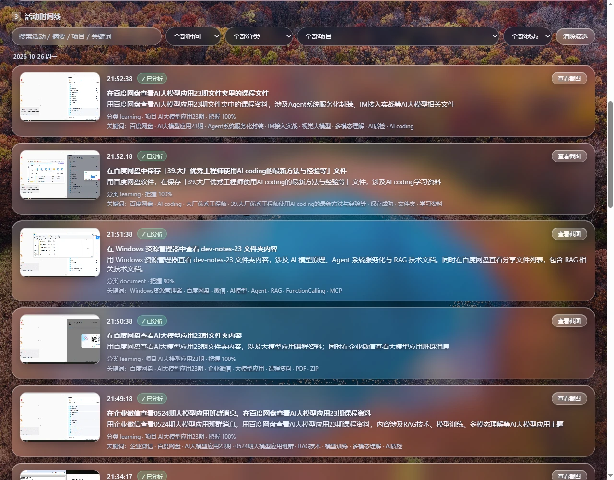
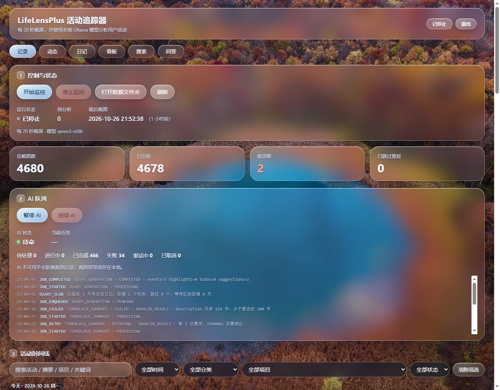
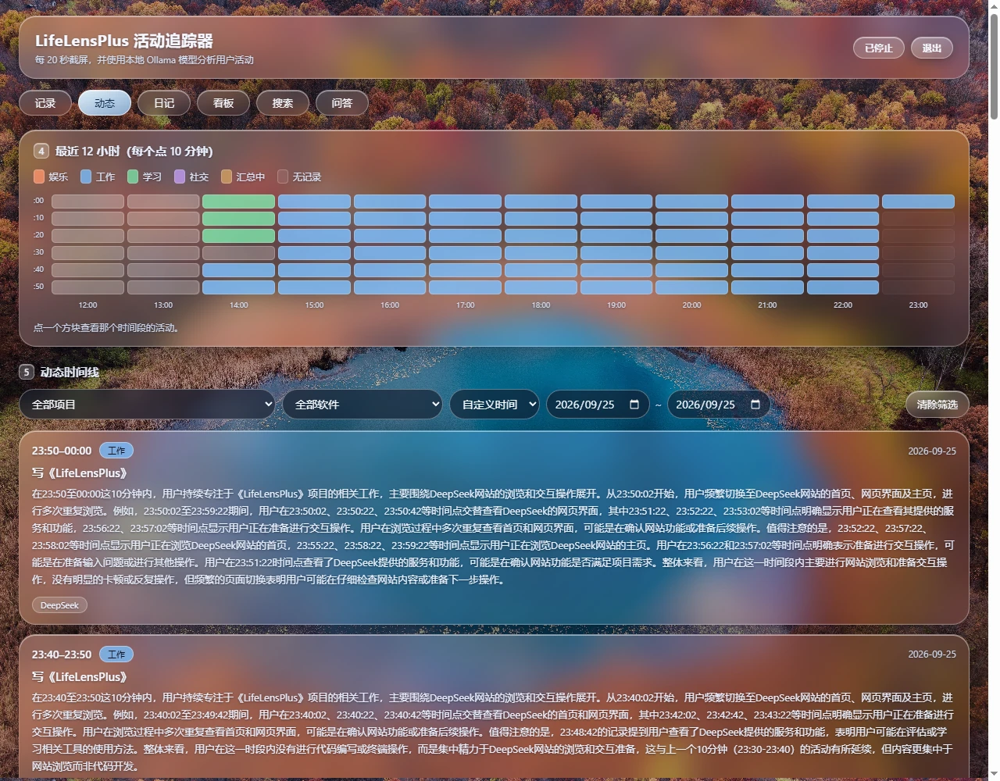
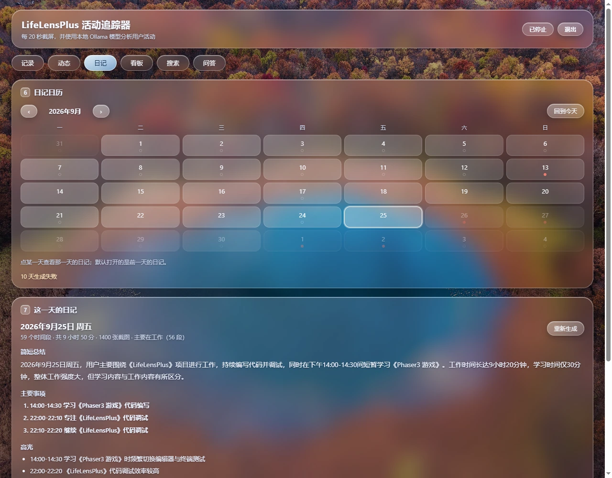
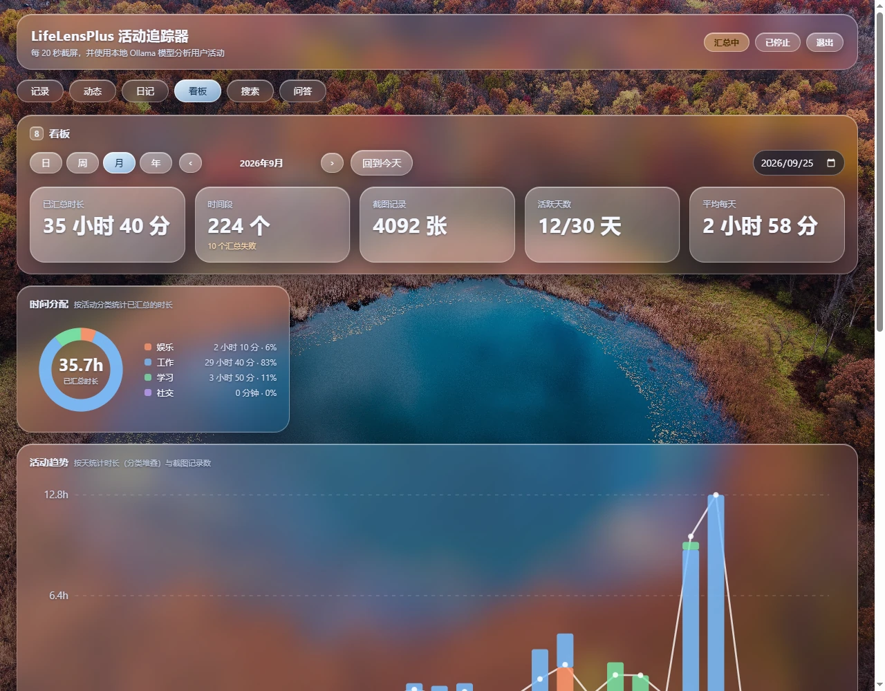
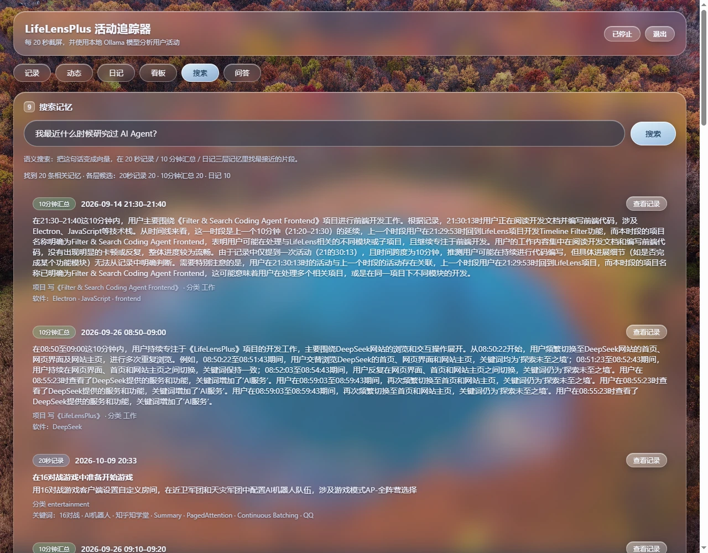
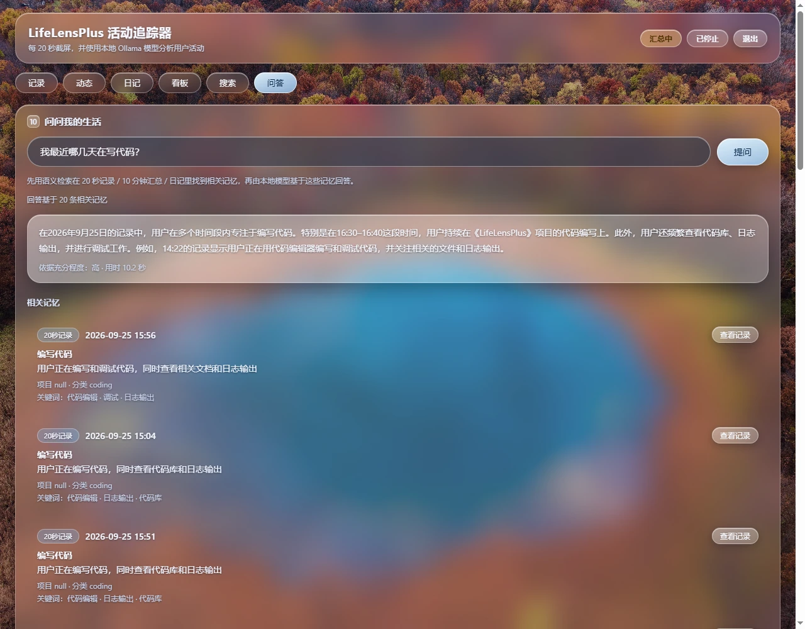
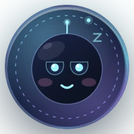
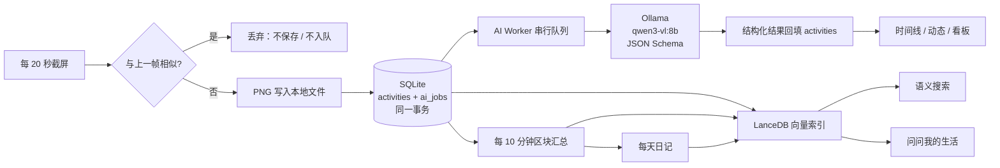

<div align="center">

# LifeLensPlus

**每 20 秒截一张屏，用本地 AI 把一天的过程整理成可以回看的记忆。**

不用手动记录，不上传任何数据，不依赖云端账号。

[中文](README.md) · [English](README.en.md)


</div>



## 这是什么

LifeLensPlus 是一个完全运行在本地的桌面「生活记录器」：它按固定间隔截取屏幕，把截图交给本机的 Ollama 视觉模型分析，再把这些碎片整理成时间线、10 分钟汇总、每日日记、统计看板和可搜索的语义记忆。

它想解决的问题很具体：**你一天下来做了很多事，但晚上回想时只剩下「好像一直在忙」。** 手动记日记坚持不了几天，而 LifeLensPlus 在你正常工作的时候就顺手把过程留下来了，晚上只需要回看和追问。

它不做的也很明确：

- **不是监控软件**：没有云端后台，没有管理员视图，没有键盘记录，没有窗口标题采集。
- **不上传数据**：截图、数据库、向量索引全部留在本机；模型也跑在本机。
- **不打断你**：截图只负责保存和入队，AI 分析在后台队列里慢慢跑，Ollama 没开也不会影响记录。

> 数据目录默认在系统「图片」文件夹下，完全由你掌控；删掉向量索引不会影响原始记录，重建即可。

## 目录

- [功能一览](#功能一览)
- [运行截图](#运行截图)
- [工作原理](#工作原理)
- [技术栈](#技术栈)
- [快速开始](#快速开始)
- [配置](#配置)
- [数据放在哪里](#数据放在哪里)
- [项目结构](#项目结构)
- [测试](#测试)
- [已知限制](#已知限制)
- [文档](#文档)
- [License](#license)

## 功能一览

| 能力 | 说明 |
| --- | --- |
| **自动记录** | 默认每 20 秒截取主显示器；与上一帧几乎相同的画面直接丢弃，不保存、不入队、不分析 |
| **本地 AI 分析** | Ollama + `qwen3-vl:8b`，通过 JSON Schema 约束结构化输出：活动、摘要、分类、项目、关键词、置信度 |
| **活动时间线** | 按天分组，支持关键词、时间范围、分类、项目、AI 状态筛选与分页 |
| **10 分钟动态** | 把一段时间内的多条记录汇总成一条「这一会儿在做什么」，带项目、软件、待办线索 |
| **每日日记** | 一天结束时做二阶汇总，生成总结、主要事件、亮点、待办、建议与提示六段内容 |
| **看板统计** | 日 / 周 / 月 / 年四个周期，时间分配、活动趋势、时段分布、项目专注、软件使用、关键词 |
| **语义搜索** | 用一句话检索三层记忆：20 秒记录、10 分钟汇总、日记；基于本地 `bge-m3` embedding + LanceDB |
| **问问我的生活** | 先检索相关记忆，再由本地模型只依据这些记忆回答，并列出依据来源 |
| **悬浮入口** | 桌面上常驻一个 56×56 的小圆标「小镜」，点击回到主界面，右键暂停 / 恢复 / 退出，并对录制、截图、分析给出表情反馈 |

## 运行截图

> 以下截图来自本机真实运行数据，不是设计稿。

### 1. 记录：自动截屏与本地 AI 分析

每张截图在后台被拆成结构化字段，AI 队列与录制循环完全解耦。Ollama 慢、模型报错、队列积压，都不会让截图停下来。



### 2. 活动时间线：一天是怎么过去的

按天分组的时间线保留了截图缩略图、活动描述、分类、项目与关键词。可以直接搜索「AI Agent」，也可以按项目或分类回看某一段时间。


### 3. 动态：每 10 分钟一段的「刚才在做什么」

热力图用颜色标注最近 12 小时的工作 / 学习 / 娱乐 / 社交分布；下方是按 10 分钟汇总的动态卡片，写明项目、软件和可能遗漏的待办。



### 4. 日记：一天结束，自动写成一篇可回看的日记

日历上的圆点表示这一天有没有记录、有没有生成日记。点开某一天，可以看到这一天的总结、主要事件、亮点、待办与建议。



### 5. 看板：把时间变成可以比较的数字

日 / 周 / 月 / 年四个周期，统计已汇总时长、时间段数量、截图数、活跃天数，并画出时间分配、活动趋势、时段分布、项目专注、软件使用与关键词。



### 6. 搜索：用一句话找回过去

「我最近什么时候研究过 AI Agent？」——本地 embedding 把问题变成向量，在 20 秒记录、10 分钟汇总、日记三层记忆里找最接近的片段；结果可以一键跳回原始记录。



### 7. 问答：问问你的生活

和搜索同一条检索链路，但会把相关记忆拼成 Context，交给本地模型生成回答，并标注依据充分程度与「相关记忆」。Prompt 明确要求模型只依据检索到的记录回答。



### 8. 悬浮入口：桌面上的小镜

56×56 的常驻圆标，录制中会跟着呼吸、暂停时暗下来，截图与分析结果会触发瞬时表情。关闭主窗口只是隐藏，后台记录继续。

<p align="center">
  
</p>

## 工作原理



几个关键设计：

- **截图与 AI 解耦**：截图循环只做「保存 PNG + 写记录 + 入队」，毫秒级完成；分析由常驻 Worker 串行执行。
- **单事务落库**：`activities` 与 `ai_jobs` 在同一个 SQLite 事务里写入。事务失败会删掉刚写的 PNG，不留下「有图没记录」的孤儿。
- **结构化输出**：分类、项目、关键词不是靠 Prompt「求 JSON」，而是 Ollama 原生 `format` + JSON Schema 约束解码，应用层再做第二层业务校验。
- **丢了也能补**：启动时恢复未完成的任务、补建缺失的分析任务；10 分钟汇总与日记都会扫描缺口后重跑。
- **三层记忆**：20 秒记录、10 分钟汇总、日记分别建向量表；SQLite 始终是唯一事实来源，LanceDB 只是可重建的索引。

## 技术栈

- **桌面**：Electron 44、原生 HTML / CSS / JavaScript，无前端框架、无构建步骤
- **存储**：Node 内置 `node:sqlite`（WAL）单文件数据库 + 文件系统截图，不用 ORM
- **AI**：Ollama 本地推理，视觉模型默认 `qwen3-vl:8b`，embedding 默认 `bge-m3`
- **语义索引**：`@lancedb/lancedb`，三张向量表；删除后可随时重建
- **界面**：手写 SVG 图表、玻璃拟态样式、无外部 UI 库
- **测试**：Node 自带 `node --test`，Ollama 全部 mock，不需要 GPU

## 详细设计
参考 [中文](docs/index.html)

## 快速开始

### 1. 环境要求

- Node.js **22.5+**（`node:sqlite` 从 22.5 开始提供；开发环境使用 22.23.2）
- 已安装 [Ollama](https://ollama.com/)
- 首次运行需要下载模型，`qwen3-vl:8b` 约 6 GB，`bge-m3` 约 1.2 GB

### 2. 拉取模型并启动 Ollama

```bash
ollama pull qwen3-vl:8b
ollama pull bge-m3
ollama serve   # 默认监听 http://127.0.0.1:11434
```

### 3. 安装并运行

```bash
npm install
npm start
```

如果 `npm start` 提示 Electron 未安装完整（首次安装时二进制未下载）：

```bash
node node_modules/electron/install.js
```

### 4. 系统权限

- **Windows**：无需额外设置
- **macOS**：首次启动需在「系统设置 → 隐私与安全性 → 屏幕录制」中授权
- **Linux**：需要 X11 或 PipeWire 桌面门户

首次启动会自动开始记录。窗口右上角可以暂停 / 恢复；悬浮入口右键可以暂停、恢复或退出。

## 配置

所有配置都通过环境变量完成，常用项如下：

| 变量 | 默认值 | 说明 |
| --- | --- | --- |
| `LIFELENS_DIR` | `图片/LifeLensPlus` | 数据目录：数据库 + 截图 |
| `LIFELENS_INTERVAL_MS` | `20000` | 截屏间隔（毫秒） |
| `LIFELENS_MODEL` | `qwen3-vl:8b` | 视觉分析模型 |
| `LIFELENS_OLLAMA_HOST` | `http://127.0.0.1:11434` | Ollama 地址 |
| `LIFELENS_AUTOSTART` | `1` | 设为 `0` 则启动后不自动记录 |
| `LIFELENS_AI_CONCURRENCY` | `1` | AI Worker 并发数（8B 模型建议保持 1） |
| `LIFELENS_AI_MAX_RETRIES` | `3` | 失败后的最大重试次数 |
| `LIFELENS_NUM_CTX` | `16384` | Ollama 上下文长度；截图按原分辨率送入，4K 屏需要足够大的上下文 |
| `LIFELENS_EMBEDDING_MODEL` | `bge-m3` | 本地 embedding 模型 |
| `LIFELENS_SUMMARY_MODEL` | 同 `LIFELENS_MODEL` | 10 分钟汇总 / 问答使用的文本模型 |

完整列表（超时、重试退避、扫描间隔、embedding 批量等）见 [docs/07-配置与运行.md](docs/07-配置与运行.md)。

## 数据放在哪里

| 数据 | 位置 |
| --- | --- |
| 活动记录、AI 任务队列 | `<LIFELENS_DIR>/lifelens.db`（SQLite，WAL 模式） |
| 截图原图 | `<LIFELENS_DIR>/<YYYY-MM>/images/<YYYY-MM-DD_HH-mm-ss-SSS>.png` |
| 语义索引（向量） | Electron 用户数据目录下的 `lancedb/`，可随时删除重建 |
| 悬浮入口位置 | Electron 用户数据目录下的 `launcher-position.json` |

`lifelens.db` 里只有结构化的文本元数据；截图内容是独立 PNG 文件，删除某张截图不会影响其他记录。数据库未加密，请像保护其他个人文件一样保护这个目录。

## 项目结构

```text
LifeLensPlus/
├── src/
│   ├── main/                 Electron 主进程
│   │   ├── main.js           窗口、IPC、启动与退出顺序
│   │   ├── recorder.js       定时截屏、入库、结果回填
│   │   ├── capture.js        截屏与送入模型前的尺寸处理
│   │   ├── ai/               AI 队列、Worker、Provider、结构化输出
│   │   ├── db/               SQLite 连接、迁移与 repositories
│   │   ├── summary/          10 分钟区块汇总
│   │   ├── diary/            每日日记生成
│   │   ├── embedding/        embedding 服务与 LanceDB 存储
│   │   ├── search/           三层记忆语义检索
│   │   ├── ask/              问答编排
│   │   ├── stats/            看板统计
│   │   └── launcher/         悬浮入口窗口与位置
│   ├── preload.js            主窗口 IPC 桥
│   ├── launcherPreload.js    悬浮入口 IPC 桥
│   └── renderer/             记录 / 动态 / 日记 / 看板 / 搜索 / 问答界面
├── test/                     node --test 测试
├── docs/                     按主题拆分的项目文档
└── screenshots/              README 运行截图
```

## 测试

```bash
npm test
```

当前 **344 个测试全部通过**。测试覆盖 AI 队列状态机与重试、结构化输出校验、SQLite 存储与事务、时间线查询、区块汇总、日记、看板、embedding 与 LanceDB、搜索、问答、悬浮入口等链路。

测试全部 mock Ollama，不需要本机运行模型或 GPU；LanceDB 使用临时目录中的真实本地文件，用完后关闭连接再清理。

## 已知限制

- 只截取主显示器，多屏会忽略其他显示器。
- 默认固定 20 秒截屏；相似帧会被丢弃，但不会根据系统事件（切窗口、锁屏）动态调整节奏。
- AI 并发默认 1，避免 8B 模型抢占显存；分析结果可能比截图晚一些回填。
- 结构化输出的稳定性依赖 Ollama 版本与模型组合；部分版本下 `qwen3-vl` 的思考文本可能与 JSON 输出冲突，详见 [docs/37-截图分析性能.md](docs/37-截图分析性能.md) 与 [docs/39-截图分辨率与识别准确度.md](docs/39-截图分辨率与识别准确度.md)。
- 4K 及以下截图按原分辨率送入模型；如果手动把 `LIFELENS_NUM_CTX` 调回 `0`，Ollama 默认 4096 上下文可能装不下 4K 截图。
- 数据库未加密，也没有云同步 / 多设备方案；数据只在本机。
- 关闭主窗口只是隐藏，录制与 AI 链路继续运行；要完全退出请用悬浮入口右键菜单或界面上的「退出」。
- `project` 只在截图里有明确证据（标题栏、文件名、网页标题）时才填写，多数截图为空；`confidence` 是模型自评，不是校准后的概率。
- 相似帧阈值（32×18 灰度网格、平均绝对差 ≤ 8）是在本机实测数据上定的，换屏幕 / 换使用习惯后可能需要调整。
- 界面与文档目前以中文为主，尚未提供国际化（i18n）。

## 文档

按主题拆分的详细文档在 [docs/](docs/README.md)：

| 主题 | 入口 |
| --- | --- |
| 架构与数据流 | [01-架构总览](docs/01-架构总览.md)、[04-数据流与事务](docs/04-数据流与事务.md) |
| 数据库与迁移 | [02-数据库设计](docs/02-数据库设计.md)、[03-迁移与版本](docs/03-迁移与版本.md) |
| AI 队列与结构化输出 | [05-AI任务队列](docs/05-AI任务队列.md) |
| 时间线 / 动态 / 日记 / 看板 | [11-Timeline界面](docs/11-Timeline界面.md)、[15-时间区块汇总](docs/15-时间区块汇总.md)、[18-日记生成](docs/18-日记生成.md)、[20-看板与统计](docs/20-看板与统计.md) |
| 记忆索引 / 搜索 / 问答 | [22-记忆索引](docs/22-记忆索引-embedding与LanceDB.md)、[24-记忆搜索](docs/24-记忆搜索.md)、[26-问答AskMyLife](docs/26-问答AskMyLife.md) |
| 悬浮入口与小镜 | [28-悬浮入口](docs/28-悬浮入口.md)、[32-小镜表情动画](docs/32-小镜表情动画.md) |
| 性能与截图质量 | [37-截图分析性能](docs/37-截图分析性能.md)、[38-相似帧过滤](docs/38-相似帧过滤.md)、[39-截图分辨率与识别准确度](docs/39-截图分辨率与识别准确度.md) |
| 测试与验证 | [06-测试与验证](docs/06-测试与验证.md) |

## 贡献

欢迎 Issue、讨论和 Pull Request。提交代码前请先跑一遍 `npm test`，并尽量保持现有的分层边界：

- SQL 只出现在 `src/main/db/`；
- Renderer 只通过 preload 暴露的 IPC 访问数据；
- Provider 负责模型调用与 Schema，队列 / Worker 不认识 Prompt 字段；
- 新增功能时同步更新 `docs/` 下对应的说明。

## License

[MIT](LICENSE) © 2026 LifeLensPlus contributors
