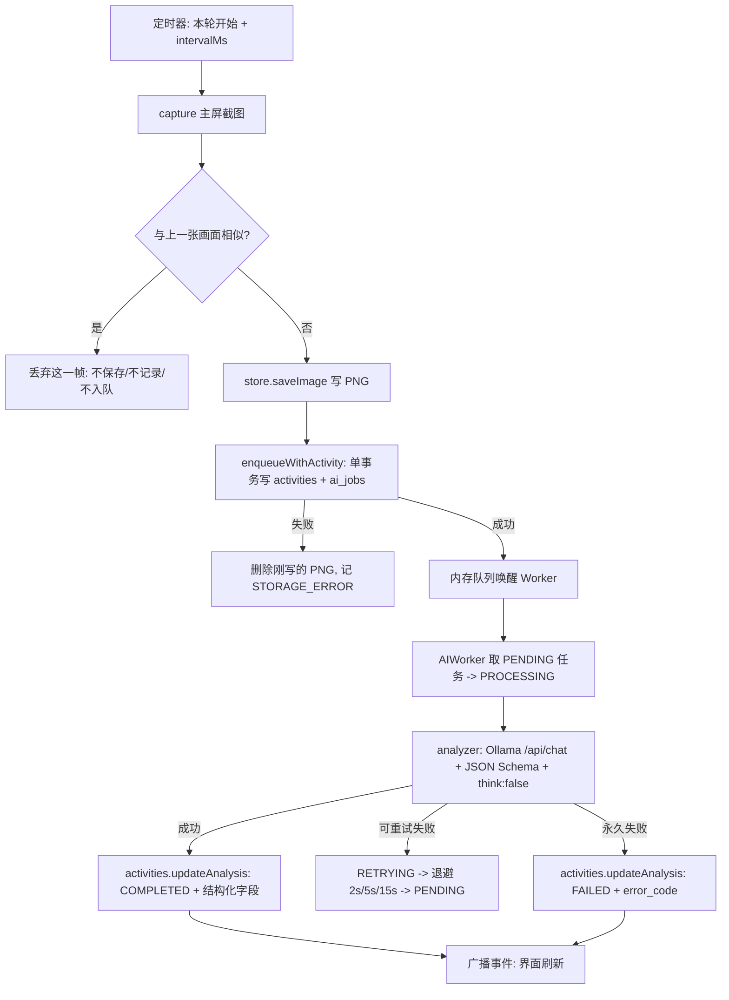
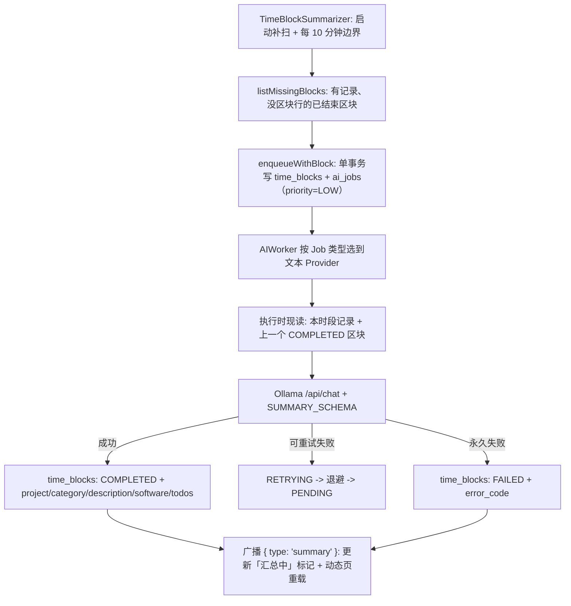
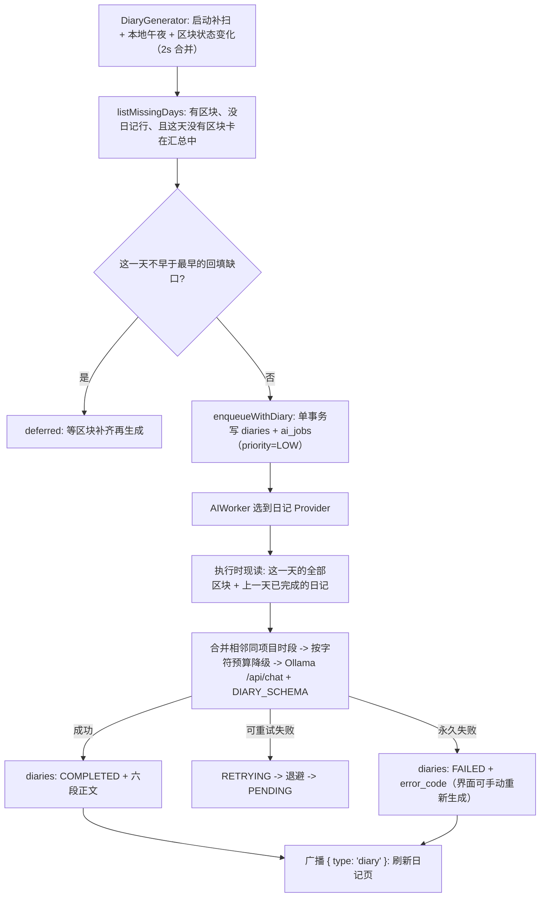

# 架构总览

## 1. 分层结构

```text
Electron Main Process（单线程，Node 24）
├── main.js                  进程编排：单实例、窗口、IPC、启动与退出顺序
├── timelineIpc.js           Timeline 查询的 IPC 通道（Phase 7.1）
├── summaryIpc.js            10 分钟区块查询 / 汇总状态 的 IPC 通道（Phase 8）
├── diaryIpc.js              日记查询 / 日历标记 / 生成状态 的 IPC 通道（Phase 9）
├── statsIpc.js              看板的统计查询 IPC 通道（Phase 9）
├── searchIpc.js             记忆搜索的 IPC 通道（Phase 11）
├── askIpc.js                问答的 IPC 通道（Phase 12）
├── launcher/                 悬浮入口（Phase 13）
│   ├── launcherWindow.js     窗口创建、三条 IPC 通道、showOrFocusMainWindow
│   └── launcherPosition.js   越界校正（纯函数）+ 位置存取（注入 fs）
├── config.js                环境变量 -> 运行时配置
├── day.js                   本地日口径：日键、区间、加减天（Phase 9）
├── recorder.js              定时截屏循环、入库、启动补偿、结果回填
├── capture.js               截屏 + 画面指纹（相似帧过滤）
├── frameSignature.js        画面指纹：32x18 灰度网格 + 平均绝对差判定（纯函数，可单测）
├── store.js                 截图文件系统存储（按月目录）
├── time.js                  本地时间格式化（带时区 ISO / 月目录 / 文件名）
├── analyzer.js              Ollama HTTP 调用与错误分类（视觉分析 + 文本汇总共用）
├── summary/                 10 分钟区块汇总（Phase 8）
│   ├── timeBlock.js         区块的时间口径（对齐、区间、业务键）
│   └── TimeBlockSummarizer.js  扫描缺口 -> 入队 -> 回填 -> 快照
├── diary/                   一天的日记（Phase 9）
│   └── DiaryGenerator.js    扫描缺口 -> 入队 -> 回填 -> 快照（启动 / 午夜 / 区块变化三个触发点）
├── search/                  三层记忆的语义检索（Phase 11）
│   └── MemorySearchService.js  三表聚合 -> 按 _distance 合并排序 -> 回查 SQLite
├── ask/                     问答（Phase 12）
│   └── AskMyLifeService.js  检索相关记忆 -> 拼 Context -> chatWithOllama -> 回答
├── stats/                   看板统计（Phase 9，纯函数）
│   ├── period.js            日 / 周 / 月 / 年的边界、标题、前后锚点、趋势分桶
│   └── summarize.js         聚合结果 -> 界面可画的完整结构（占比、时长、排行、分桶）
├── db/                      SQLite 数据层（唯一出现 SQL 的地方）
│   ├── database.js          打开/关闭连接、PRAGMA、事务包装
│   ├── schema.js            表与索引的 DDL、SCHEMA_VERSION
│   ├── migrations.js        user_version 驱动的 migration runner
│   ├── jobRow.js            ai_jobs 列清单与取值映射（两个 repository 共用）
│   └── repositories/
│       ├── ActivityRepository.js    activities 的读写与统计
│       ├── AIJobRepository.js       ai_jobs 的快照持久化
│       ├── TimeBlockRepository.js   time_blocks 的读写与缺口扫描（Phase 8）
│       ├── DiaryRepository.js       diaries 的读写、缺口扫描与日历标记（Phase 9）
│       └── StatsRepository.js       看板的聚合查询（Phase 9，只读）
└── ai/                      AI 任务子系统
    ├── job.js               Job 数据模型、状态机、优先级
    ├── AIJobQueueService.js 队列调度、去重、重试计时、状态持久化
    ├── AIWorker.js          并发执行器：取任务、按类型选 Provider、回填状态
    ├── visionProvider.js    Provider 实现（Ollama 视觉模型）
    ├── summaryProvider.js   Provider 实现（Ollama 文本汇总，Phase 8）
    ├── diaryProvider.js     Provider 实现（Ollama 一天的日记，Phase 9）
    ├── structuredOutput.js  JSON Schema、Prompt、第二层校验
    ├── summaryOutput.js     汇总的 JSON Schema、Prompt、第二层校验（Phase 8）
    ├── diaryOutput.js       日记的 JSON Schema、Prompt、时段合并与上下文压缩（Phase 9）
    ├── errors.js            错误码与可重试判定
    └── jobEventLog.js       任务事件日志（只记元信息）

Renderer（沙箱，无 Node）
├── preload.js               主窗口：contextBridge 暴露的 IPC 接口
├── launcherPreload.js       悬浮入口：只暴露 openMain / dragMove / dragEnd（Phase 13）
└── renderer/                界面：标签页（记录 / 动态 / 日记 / 看板 / 搜索 / 问答）
    ├── timeline.js          活动时间线（Phase 7.2）
    ├── dynamics.js          动态页：热力图 + 区块时间线 + 筛选（Phase 8）
    ├── diary.js             日记页：月历 + 一天的六段日记（Phase 9）
├── kanban.js            看板页：四个周期的多维度图表（Phase 9，手写 SVG）
├── search.js            搜索页：自然语言搜索框、结果卡片、最近搜索与跳转（Phase 11）
├── ask.js               问答页：提问、回答与依据充分程度、相关记忆与跳转（Phase 12）
├── launcher.html / .css / .js  悬浮入口：圆标、样式、手势（Phase 13）
└── renderer.js          状态、记录列表、AI 队列面板、标签页与「汇总中」标记
```

## 2. 运行时数据流



### 2.1 区块汇总链路（Phase 8，与上面并行）



### 2.2 动态页读取链路

```text
Renderer(dynamics.js)
  -> preload: getTimeBlocks / getTimeBlockFacets / getSummaryStatus
  -> summaryIpc: lifelens:time-blocks / -facets / lifelens:summary-status
  -> TimeBlockRepository.queryBlocks / listBlocksBetween / listFacets、TimeBlockSummarizer.snapshot
  -> SQLite time_blocks
```

### 2.3 日记链路（Phase 9，接在区块汇总之后）



### 2.4 看板读取链路

```text
Renderer(kanban.js)
  -> preload: getStats({ period, anchor })
  -> statsIpc: lifelens:stats
  -> StatsRepository.summarize（12 条聚合查询）
  -> stats/summarize.buildStats（纯函数二次汇总：占比 / 时长 / 分桶 / 排行）
  -> SQLite time_blocks + activities
```

### 2.5 记忆搜索链路（Phase 11）

```text
Renderer(search.js)
  -> preload: searchMemories(query, limit)
  -> searchIpc: lifelens:memory-search
  -> MemorySearchService.search
       -> provider.embedText（同一个 Provider，同一份维度校验）
       -> activity_vectors / block_vectors / diary_vectors 各 search 一次
       -> 按 _distance 升序合并、截取前 limit 条
       -> getById / getByStart / getByDay 回查 SQLite 取完整记录
  -> 结果卡片；点击后切到「记录」并 timeline.focus，或切到「日记」并 diary.selectDay
```

回查 SQLite 时三层 `source_id` 的语义不同：`activity` 是 `activities.id`、`block` 是 `block_start`、
`diary` 是 `day`。向量表里没有 `source_type` 列，来源类型由「查的是哪张表」决定。

### 2.6 问答链路（Phase 12，接在记忆搜索之后）

```text
Renderer(ask.js)
  -> preload: ask(question)
  -> askIpc: lifelens:ask
  -> AskMyLifeService.ask
       -> MemorySearchService.search(question, { limit: 20 })   检索 + 回查 SQLite（不重复 hydration）
       -> buildContext：单条 300 字 / 总长 8000 字 / 无正文不进 Context
       -> chatWithOllama(format=QA_SCHEMA, numCtx, think=false, num_predict=1024)
  -> { answer, confidence, memories[] }
  -> 点相关记忆：切到「记录」并 timeline.focus，或切到「日记」并 diary.selectDay（复用搜索页的跳转）
```

空问题与「没有可用记忆」都在服务层短路（不调模型）；检索失败与生成失败分别带固定前缀抛错，
由 renderer 用 `cleanErrorMessage` 取可读部分展示。
跳转与结果卡片渲染只在 `renderer/search.js` 里存在一份，通过 `window.lifelensSearchKit` 共享。

### 2.7 窗口生命周期（Phase 13）

```text
app.whenReady()
  ├── createWindow()       主窗口（loadFile index.html）
  └── createLauncher()     悬浮入口（loadFile launcher.html，56x56 透明置顶）

主窗口 close 事件
  ├── quitting 未置位 -> preventDefault + hide()   应用与后台链路继续
  └── quitting 已置位 -> 放行销毁                  退出流程中

launcher 的 close 事件：同一套规则（隐藏 / 放行）

点击悬浮球 -> lifelens:launcher-open -> showOrFocusMainWindow()（不存在则重建 / 隐藏则显示 / 可见则聚焦）
拖动悬浮球 -> lifelens:launcher-move -> clampToWorkArea -> setPosition
              lifelens:launcher-end  -> 写 <userData>/launcher-position.json
点「退出」 -> lifelens:quit -> app.quit() -> 原有 before-quit 收尾流程（内容与顺序未改）
```

`before-quit` 的 `quitting` 标志被两个窗口的 close 拦截共用，没有引入第二个状态。
`activate`（macOS）与 `second-instance` 都改走 `showOrFocusMainWindow`：
launcher 常驻后 `getAllWindows().length === 0` 永远不成立，而隐藏的主窗口只 `focus()` 唤不出来。

## 3. 模块职责边界

| 模块 | 负责 | 明确不负责 |
| --- | --- | --- |
| `recorder.js` | 截屏节奏、写记录、建任务、回填结果 | 不写 SQL、不调 Ollama、不等 AI |
| `AIJobQueueService` | 队列状态、去重、优先级、重试计时、持久化调用 | 不认识截图、不调模型 |
| `AIWorker` | 并发取任务、调 Provider、状态流转 | 不认识 Prompt / Schema 字段 |
| `analyzer.js` + `visionProvider.js` | HTTP 调用、错误分类、结构化校验 | 不碰数据库、不碰界面 |
| `db/repositories` | SQL、行 ↔ 业务对象映射 | 不含业务规则（重试、优先级等） |
| `timelineIpc.js` | 把 Timeline 查询暴露成 IPC 通道 | 不写 SQL、不含分页与时间范围规则（都在 repository） |
| `summary/timeBlock.js` | 10 分钟区块的时间口径（对齐、区间、业务键） | 不碰数据库、不碰 AI |
| `summary/TimeBlockSummarizer.js` | 扫描缺口、排队、回填汇总结果、给界面提供快照 | 不写 SQL、不调 Ollama、不认识 Prompt 字段 |
| `summaryProvider.js` + `summaryOutput.js` | 汇总的 HTTP 调用、Schema、Prompt、第二层校验 | 不碰数据库（素材由注入的 `loadContext` 提供） |
| `summaryIpc.js` | 把区块查询与汇总状态暴露成 IPC 通道 | 不写 SQL、不含筛选规则（都在 repository） |
| `day.js` | 本地日口径：日键、区间、加减天、严格校验 | 不碰数据库、不碰 AI、不认识周期（那是 `stats/period.js`） |
| `diary/DiaryGenerator.js` | 扫描缺口、排队、回填日记、给界面提供快照 | 不写 SQL、不调 Ollama、不认识 Prompt 字段 |
| `diaryProvider.js` + `diaryOutput.js` | 日记的 HTTP 调用、Schema、Prompt、时段合并与上下文压缩 | 不碰数据库（素材由注入的 `loadContext` 提供） |
| `diaryIpc.js` | 把日记查询 / 日历标记 / 生成状态暴露成 IPC 通道 | 不写 SQL、不做日期数学（都在 `day.js` 与 repository） |
| `stats/period.js` | 周期口径：边界、标题、前后锚点、分桶 | 不碰数据库、不碰 DOM |
| `stats/summarize.js` | 聚合规则的二次汇总（占比、时长、排行、分桶） | 不写 SQL、不碰 DOM |
| `StatsRepository.js` | 看板的聚合查询（只读） | 不含聚合规则（都在 `stats/summarize.js`） |
| `search/MemorySearchService.js` | 三层记忆的聚合语义检索：三表各查一次、按 `_distance` 合并排序、回查 SQLite、来源类型解析 | 不写 SQL、不碰 LanceDB 原生模块、不做 Prompt 与生成式问答 |
| `searchIpc.js` | 把记忆搜索暴露成 IPC 通道 | 不写 SQL、不含检索规则（都在 `MemorySearchService`） |
| `ask/AskMyLifeService.js` | 问答编排：检索相关记忆、拼 Context、调本地模型、校验回答、错误口径 | 不依赖 SQLite repositories、不碰 LanceDB 原生模块、不做多轮与 Query Rewrite |
| `askIpc.js` | 把问答暴露成 IPC 通道 | 不含 Prompt、不拼 Context、不写 SQL |
| `renderer/diary.js` | 月历、一天详情的分级渲染 | 不直接访问数据库（只走 IPC）、不做日期边界计算 |
| `renderer/kanban.js` | 四个周期的多维度图表（手写 SVG） | 不直接访问数据库（只走 IPC）、不做日期数学 |
| `renderer/search.js` | 搜索页：输入、Loading / 空 / 错误态、结果卡片、最近搜索、跳转指令 | 不访问数据库与向量库（只走 IPC）、不做向量计算；定位交给 timeline / diary |
| `renderer/ask.js` | 问答页：输入、Loading / 空 / 错误态、回答与依据充分程度、相关记忆、跳转 | 不访问数据库与向量库（只走 IPC）、不拼 Prompt、不复制跳转逻辑（用 `lifelensSearchKit`） |
| `renderer/dynamics.js` | 热力图、区块时间线、筛选 | 不直接访问数据库（只走 IPC） |
| `renderer/launcher.js` | 悬浮球的手势判定（阈值纯函数）与视图装配 | 不操作 BrowserWindow（只走 launcherPreload 的三个方法）、不认业务数据 |
| `launcher/launcherWindow.js` | 悬浮入口窗口、三条 `lifelens:launcher-*` 通道、`showOrFocusMainWindow`（三处共用） | 不碰业务链路、不写位置文件（保存回调由 main.js 注入） |
| `launcher/launcherPosition.js` | 越界校正（纯函数）、位置文件读写 | 不认识 electron / screen（workArea 由调用方传入）、不碰 SQLite 与 outputDir |
| `renderer` | 展示与用户操作 | 不直接访问数据库（只走 IPC） |

## 4. 设计原则

- **SQLite 是唯一的结构化数据源**：不再有 JSON 持久化，也不做 JSON 双写。
- **文件系统只存图片**：`store.js` 只保留 `monthDir` / `imageDir` / `saveImage`。
- **SQL 集中在 `src/main/db/`**：Recorder / Queue / Worker / Main / Renderer 里没有 SQL 字符串。
- **不引入 ORM**：prepared statement + repository 足够覆盖当前查询。
- **同步驱动，异步接口**：`node:sqlite` 是同步 API，repository 暴露同步方法，
  调用方（`async` 函数）的写法保持不变，改动最小。
- **失败要留痕**：数据库写入失败、找不到关联记录等异常都会记入 `JobEventLog`。
