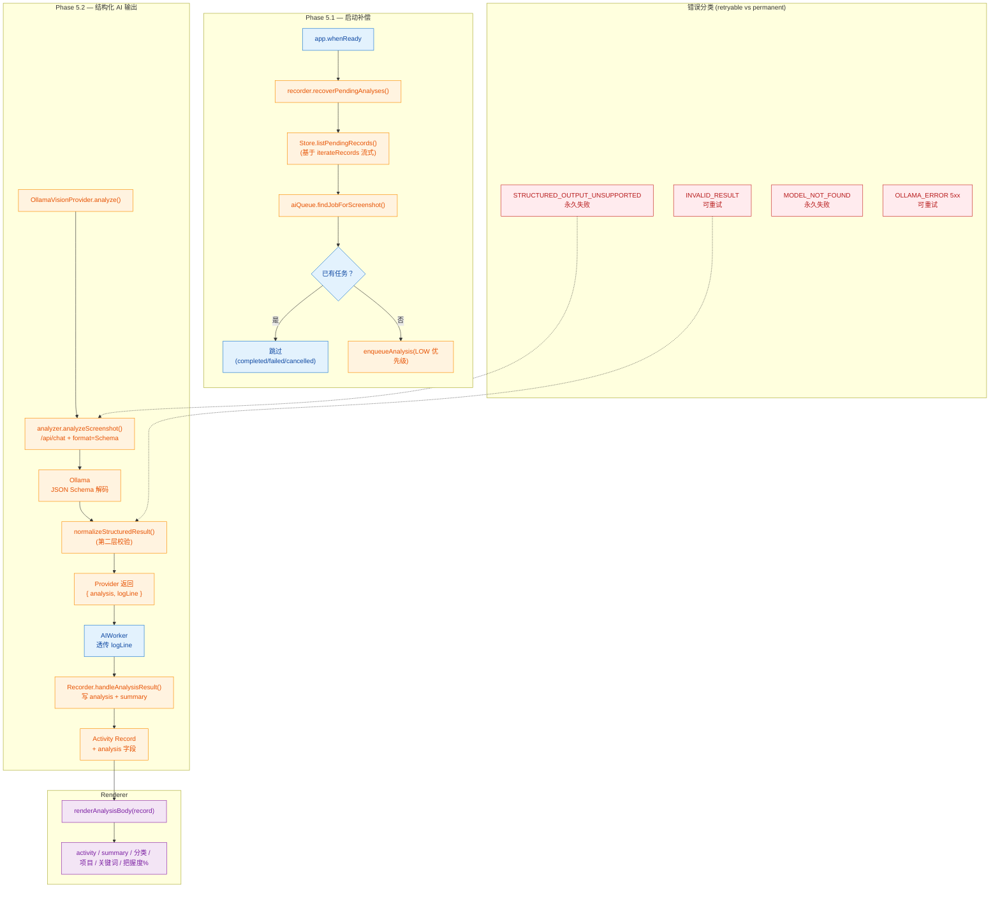
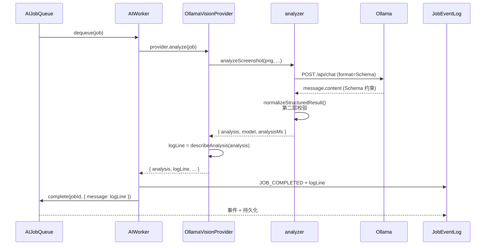

<markdown_report>
## 1. 高层摘要 (TL;DR)

*   **影响:** 🔥 **High** - 一次性合并了两个关键阶段：
    *   **Phase 5.1**：AI Job 启动补偿（修复"记录已落盘、任务未入队"的孤儿 PENDING 记录）。
    *   **Phase 5.2**：AI 输出由自由文本升级为 Ollama 原生 **JSON Schema 结构化输出**（activity/summary/category/project/keywords/confidence）。
*   **关键变更:**
    *   新增 `src/main/ai/structuredOutput.js`：定义 JSON Schema、Prompt、第二层校验与日志摘要生成。
    *   `analyzer.js`：从 `/api/generate` 切到 `/api/chat`，并通过 `format` 参数注入 Schema；新增 `STRUCTURED_OUTPUT_UNSUPPORTED` 错误码。
    *   `Recorder`：新增 `recoverPendingAnalyses()`、`analysis` 字段写入、任务优先级 `JOB_PRIORITY.LOW` 补偿任务。
    *   `AIJobQueueService` / `AIWorker`：`complete(jobId, { message })` 与 `findJobForScreenshot()`，将 Provider 的一行日志透传给事件流。
    *   `Store`：抽出 `iterateRecords()` 流式迭代器，新增 `listPendingRecords()`，避免把整库读进内存。
    *   渲染层 (`renderer.js` / `styles.css`)：用 `renderAnalysisBody()` 渲染结构化字段（活动短语、分类、项目、置信度、关键词）。
    *   新增 3 个测试文件 + 2 个 promt 文档。

---

## 2. 视觉概览 (Code & Logic Map)



---

## 3. 详细变更分析

### 🟦 阶段 5.1：启动补偿机制（Job Recovery）

#### 业务目标
> 解决「Activity 记录已落盘、但 AI Job 还没来得及入队」就被关闭的孤儿 PENDING 记录。

#### 新增/修改文件

| 文件 | 变更 |
| --- | --- |
| `src/main/recorder.js` | 构造函数新增 `log`，新增 `recoverPendingAnalyses()`，`enqueueAnalysis()` 支持 `priority` |
| `src/main/ai/AIJobQueueService.js` | 导入 `AIJobType`，`complete()` 支持 `{ message }`，新增 `findJobForScreenshot()` |
| `src/main/ai/AIWorker.js` | 调用 `queue.complete(job.id, { message: result?.logLine ?? null })` |
| `src/main/ai/jobEventLog.js` | 新增 `EVENTS.RECOVERY_SCAN` |
| `src/main/store.js` | 抽出 `iterateRecords()`（async generator）+ `listPendingRecords()` |
| `src/main/main.js` | `aiWorker.start()` 后立即调用 `recorder.recoverPendingAnalyses()`，不阻塞窗口 |
| `test/recovery.test.js` *(新)* | 7 个用例：补建、跳过、跨重启 |

#### 关键逻辑：`Recorder.recoverPendingAnalyses()`

```javascript
// 优先级低于实时截图，保证新截图的记录先被分析
const job = await this.enqueueAnalysis(record, { priority: JOB_PRIORITY.LOW });
if (job) created += 1;
```

*   ✅ 只补建「**从来没有任务**」的 PENDING 记录。
*   ❌ 已有任务（COMPLETED / FAILED / CANCELLED / PROCESSING）一律跳过，**失败不会自动复活**。
*   ❌ 异常被 `try/catch` 兜住，写入 `RECOVERY_SCAN` 事件，不会让启动崩溃。

#### `Store.iterateRecords()` 设计要点
*   改用 `async function*` 流式迭代，**不再把全库读进内存**。
*   月份/小时文件名 `.sort()` 排序 → 产出顺序与时间一致。
*   `loadStats()` 改为复用迭代器。

---

### 🟧 阶段 5.2：结构化 AI 输出（Structured Output）

#### 业务目标
> 用 Ollama 原生 JSON Schema 替换 Prompt 求 JSON 的脆弱方案；Worker / Queue 不感知字段；旧记录向后兼容。

#### 新增/修改文件

| 文件 | 变更 |
| --- | --- |
| `src/main/ai/structuredOutput.js` *(新)* | JSON Schema、Prompt、归一化、日志摘要 `describeAnalysis()` |
| `src/main/analyzer.js` | `/api/generate` → `/api/chat`；新增 `format: STRUCTURED_AI_SCHEMA`；删 `splitSentences` / 旧 `PROMPT`；`httpError()` 抽出 |
| `src/main/ai/visionProvider.js` | `summarize` → `analyzeScreenshot`；删除 `maxSummarySentences`；返回 `analysis` + `logLine` |
| `src/main/ai/errors.js` | `EMPTY_RESULT` → `INVALID_RESULT`（可重试）；新增 `STRUCTURED_OUTPUT_UNSUPPORTED`（永久失败） |
| `src/main/recorder.js` | 写 `analysis` 字段；`summary` 镜像自 `analysis.summary`；`sentences: []` |
| `src/main/config.js` | 删除 `maxSummarySentences` |
| `src/main/main.js` | Provider 构造去掉 `maxSummarySentences`；传入 `log: jobLog` |
| `src/renderer/renderer.js` | 新增 `renderAnalysisBody()`；AI 日志追加 `entry.message` |
| `src/renderer/styles.css` | 新增 `.record-activity / .record-summary / .record-meta / .record-keywords` |
| `README.md` | 文档：结构化输出 Schema 表、字段约束、可重试/不重试规则、限制 |
| `test/structuredOutput.test.js` *(新)* | 12+ 个用例：Schema/校验/Provider/集成 |
| `test/store.test.js` *(新)* | `iterateRecords` / `updateRecord` / `loadStats` / `listPendingRecords` |

#### 错误码语义（新增/调整）

| 错误码 | 可重试 | 触发条件 |
| --- | --- | --- |
| `INVALID_RESULT` | ✅ | Schema 已通过但业务字段非法（缺字段、category 越界、confidence 越界、project 类型错、keywords 非数组、超长等） |
| `STRUCTURED_OUTPUT_UNSUPPORTED` | ❌ | Ollama 400/422 且 body 含 `format/schema/grammar/structured` 关键字 |

> 备注：`EMPTY_RESULT` 被 `INVALID_RESULT` 取代（content 为空 / JSON 解析失败 / 落进 thinking 字段，都归为 `INVALID_RESULT`）。

#### Provider 边界（解耦亮点）


*   **Worker 与 Queue 不知道任何字段**（activity / category / project / keywords / confidence）。
*   换 OpenAI / Gemini 时只需替换 `OllamaVisionProvider`，Schema 与校验随 Provider 走。

#### 故意不传 `think:false`
> 实测（Ollama 0.34 + `qwen3-vl:8b`）在 `format` 约束下同时传 `think:false` 会把整段 JSON 留在 `thinking` 字段里，导致 `message.content` 为空。
> 所以 `analyzer.js` 刻意省略 `think:false`（`structuredOutput.test.js` 也用 `'think' in body === false` 锁死这个行为）。

#### Schema 字段说明

| 字段 | 类型 | 约束 | UI 显示 |
| --- | --- | --- | --- |
| `activity` | string | 非空、≤100 字、自动 trim | 加粗短语 |
| `summary` | string | 非空、≤500 字 | 自然语言总结 |
| `category` | enum (13 项) | 必须在 `AI_CATEGORIES` 中 | `分类 coding` |
| `project` | string \| null | 空串/纯空白 → `null` | `项目 Life Lens` |
| `keywords` | string[] | 0–8 个、trim/去空/去重、按序截断 | `关键词：Electron · JavaScript` |
| `confidence` | number | 0 ≤ x ≤ 1；超界即失败 | `把握 94%`（`Math.round(c * 100)%`） |

#### 第二层校验位置
`src/main/ai/structuredOutput.js` 的 `normalizeStructuredResult()`，覆盖：
*   JSON 解析失败 / Markdown 代码块剥离
*   `requireText()`：类型/空串/长度
*   `normalizeProject()`：空串/空白 → null
*   `normalizeKeywords()`：非数组/非字符串 → 失败
*   `normalizeConfidence()`：非有限数/越界 → 失败
*   类别不在枚举 → 失败

---

## 4. 影响 & 风险评估

### ⚠️ 破坏性变更（Backward-Incompatible）

| 项 | 影响 |
| --- | --- |
| `EMPTY_RESULT` 错误码被移除 | 若外部/日志解析依赖 `EMPTY_RESULT`，需切到 `INVALID_RESULT` |
| `summarize()` 导出名 | `analyzer.js` 不再导出 `summarize` / `splitSentences` / `PROMPT`，已全部切到 `analyzeScreenshot` |
| `/api/generate` → `/api/chat` | 自定义 Ollama 代理 / 旧版 Ollama 需支持 chat 接口 |
| `visionProvider` 构造函数 | 移除 `maxSummarySentences` 参数；调用方需同步 |
| `config.maxSummarySentences` | 配置项删除 |
| `Recorder` 构造函数 | 仍兼容（`log` 默认 null），但调用方若要日志事件需传入 |

### 🟢 兼容性保留

*   旧 Activity 记录（无 `analysis` 字段）→ 渲染层走 `sentences` 回退路径。
*   `summary` 顶层镜像自 `analysis.summary`，旧读取方无需改造。
*   `Provider` 仍暴露 `analyze()` / `health()`；AIWorker 接口不变。

### 🐛 风险点

1.  **启动补偿跑在主进程**：`recoverPendingAnalyses()` 在 `main.js` 里和 `aiWorker.start()` 串行调用，但 `iterateRecords` 是流式的；理论上记录量巨大时仍会占用主进程 IO 循环（但不会再爆内存）。建议监控日志中的 `RECOVERY_SCAN` 事件。
2.  **`STRUCTURED_OUTPUT_UNSUPPORTED` 的关键字识别**：`UNSUPPORTED_FORMAT_HINT = /(format|schema|grammar|structured)/i` 依赖 Ollama 错误文案，跨版本可能漂移（建议在 README 里记一下）。
3.  **`describeAnalysis` 的 `confidence` 序列化**：直接拼到日志里，未做位数截断，`0.9399999999` 会原样出现。
4.  **`Renderer` 中 `confidence * 100` 的 0% 边界**：`Math.round(0.001 * 100) = 0`；当 `confidence` 极小时会显示 `0%`，可能误导用户（建议加一个最低阈值或回退 `null`）。

### 🧪 建议测试场景

*   **跨重启**：手动制造 `pendingRecord` + 关闭 → 重启 → 验证补建任务。
*   **Provider 替换**：mock 一个返回 `INVALID_RESULT` 的 Provider，确认截图不停、记录 `analysis: null`、`errorCode = INVALID_RESULT`。
*   **老数据回归**：把 Phase 5 之前的 `summary` 记录塞进库，确认 UI 走 `sentences` 分支。
*   **置信度边界**：`0` / `1` / 极小数（如 `0.001`）/ `NaN` 字符串化（`'0.9'`）。
*   **不支持 Schema 的 Ollama**：用 400 + body 含 `format` 字样的 mock，验证 `STRUCTURED_OUTPUT_UNSUPPORTED` 不被 Worker 重试。
*   **Renderer**：`record.analysis` 部分字段缺失（如只有 `activity` / `summary`）的展示。

---

## 5. 总评

✅ **优点**
*   严格遵守 Provider 抽象，AIWorker 与 Queue 不感知 schema 字段 → 可替换性大幅提升。
*   Schema + 业务双层校验，对模型"自由发挥"做了有效隔离。
*   流式 `iterateRecords()` 改造，让启动补偿的内存占用可控。
*   启动补偿不会让"失败"任务复活（避免每次启动都跑一遍失败分析）。
*   测试覆盖到位：Schema、归一化、Provider mock、UI 集成、跨重启、失败不阻塞截图。

⚠️ **需关注**
*   `STRUCTURED_OUTPUT_UNSUPPORTED` 的关键字匹配对 Ollama 文案耦合。
*   `confidence` 在 UI 上 `0%` 边界和日志的原始小数序列化。
*   `EMPTY_RESULT → INVALID_RESULT` 错误码切换需要通知到任何依赖旧码的外部脚本。
*   大量历史 `summary` 记录无 `analysis`，可考虑未来跑一次性 `backfill`（但当前不必要，旧数据按 `sentences` 展示）。