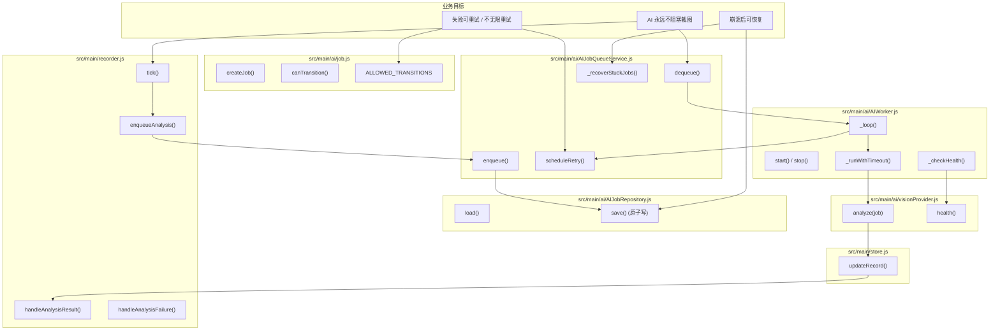
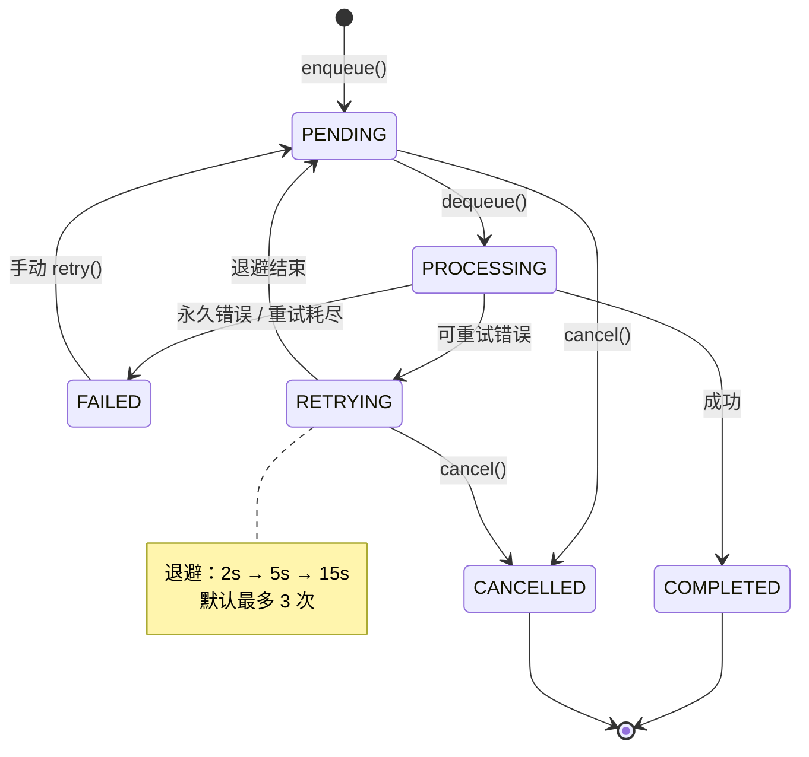
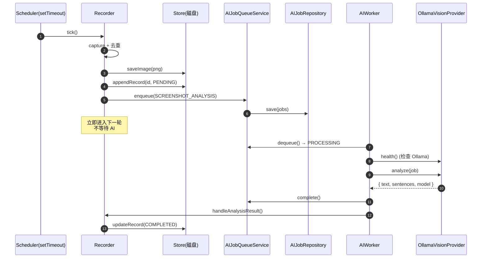

## 1. 高级概览（TL;DR）

*   **影响：🔴 高** —— 引入全新的 **AI 后台任务队列子系统**，将"截图"与"AI 分析"彻底解耦，属于 Phase 5 阶段性大重构。
*   **核心变更：**
    *   🆕 新增 `src/main/ai/` 模块（7 个文件），实现 Job 数据模型、持久化仓库、队列服务、Worker、Vision Provider、错误体系与事件日志。
    *   ♻️ 重构 `recorder.js`：**不再同步调用 Ollama**，截图后只入队 + 立即返回。
    *   🆕 `store.js` 新增 `updateRecord()`：AI 完成后回填原记录（PENDING → COMPLETED/FAILED）。
    *   🆕 界面新增「AI 队列」面板（暂停/继续、状态指示、统计、日志）。
    *   🆕 三套测试套件（`node --test`）覆盖状态机、Worker、截图解耦。

---

## 2. 可视化总览（架构与代码地图）

### 2.1 业务目标 ↔ 模块 ↔ 关键方法映射



### 2.2 状态机（核心设计）



### 2.3 截图与分析解耦流程



---

## 3. 详细变更分析

### 3.1 核心：AI 子系统（全新）— `src/main/ai/`

#### `job.js` —— AI Job 数据模型与状态机

*   **做了什么**：定义 `AIJobType`（5 种，仅实现 `SCREENSHOT_ANALYSIS`）、`AIJobStatus`（6 种）、`JOB_PRIORITY`、`ALLOWED_TRANSITIONS`、工厂函数 `createJob()`。
*   **关键设计**：状态机表驱动，`canTransition()` 阻止任何非法跳转（如 `COMPLETED → PROCESSING`）。

| 状态 | 允许的下一状态 |
|------|----------------|
| PENDING | PROCESSING / CANCELLED |
| PROCESSING | COMPLETED / FAILED / RETRYING |
| RETRYING | PENDING / CANCELLED |
| FAILED | PENDING（仅手动 retry） |
| COMPLETED | （终态） |
| CANCELLED | （终态） |

#### `errors.js` —— 错误体系

*   **做了什么**：定义 `ERROR_CODES`（10 种）、`AIError` 类、`PERMANENT_CODES` 集合、`isRetryable()`。
*   **设计要点**：通过 `retryable` 字段区分错误类型，避免无效重试。

| 错误码 | 是否可重试 | 触发场景 |
|--------|-----------|----------|
| `AI_TIMEOUT` | ✅ | 单次推理超过 120s |
| `OLLAMA_UNAVAILABLE` | ✅ | 连不上 Ollama |
| `OLLAMA_ERROR` | ✅ | Ollama 5xx |
| `MODEL_NOT_FOUND` | ❌ | 404 模型没拉取 |
| `IMAGE_NOT_FOUND` | ❌ | 截图文件不存在 |
| `IMAGE_INVALID` | ❌ | 截图解码失败 |
| `OLLAMA_BAD_REQUEST` | ❌ | 4xx 参数错误 |
| `EMPTY_RESULT` | ✅ | 模型返回空 |

#### `AIJobRepository.js` —— 持久化

*   **做了什么**：读写 `ai-jobs.json`，复用 `store.js` 的 `writeJsonAtomic`（已处理 Windows `EBUSY`）。
*   **关键设计**：写入串行化（`chain` Promise 链），失败不会阻断下一次写入。

#### `AIJobQueueService.js` —— 队列服务（424 行核心代码）

*   **做了什么**：纯状态管理 —— `enqueue/dequeue/complete/fail/scheduleRetry/cancel/retry/reanalyzeScreenshot`。
*   **关键方法**：

| 方法 | 行为 |
|------|------|
| `enqueue()` | 重复任务防护：同截图 + 同类型 = 拒绝（除非 `force=true`） |
| `scheduleRetry()` | 状态改为 RETRYING，按 `retryDelaysMs[retryCount]` 退避后回 PENDING |
| `_recoverStuckJobs()` | ⚡ 启动时强制把 PROCESSING/RETRYING 恢复为 PENDING（崩溃恢复） |
| `_pruneTerminalJobs()` | 终态 Job 超过 500 条时裁剪最早的 |
| `reanalyzeScreenshot()` | 为历史截图重建 HIGH 优先级任务 |

#### `AIWorker.js` —— 长期运行 Worker

*   **做了什么**：长循环 `_loop()` → 取任务 → 健康检查 → 推理 → 回填。
*   **关键设计**：
    *   `_runWithTimeout()` 用 `Promise.race` 兜底超时，绝不卡在 PROCESSING。
    *   `_checkHealth()` 每 `healthPollMs` 探测 Ollama 状态，离线时不取任务。
    *   `_waitForWork()` 同时监听 `wake/paused/resumed` 事件，避免轮询浪费。

#### `visionProvider.js` —— Ollama 视觉模型适配层

*   **做了什么**：封装 `analyze()` / `health()`，将原始错误统一转为 `AIError`。
*   **解耦价值**：未来换 OpenAI/Claude/本地模型只需替换 Provider，Queue/Worker 不动。

#### `jobEventLog.js` —— 事件日志

*   **做了什么**：内存环形缓冲（最多 100 条）+ 输出到 `console`。
*   **隐私保证**：**只记录元信息（jobId/类型/状态/错误码）**，绝不记录截图内容、路径、Prompt。

---

### 3.2 截图与 AI 解耦 —— `recorder.js`（重构）

*   **关键变更**：
    *   ❌ 删除了同步的 `summarize()` 调用，截图流程不再 `await` AI。
    *   ✅ 引入 `enqueueAnalysis()`，截图后立即入队，不阻塞。
    *   ✅ 引入 `handleAnalysisResult()` / `handleAnalysisFailure()` 由 Worker 回调。
    *   ✅ 记录中新增 `id`（= 文件名去后缀）、`analysisStatus` 字段。

```javascript
// 重构前：截图 → await summarize() → 写记录
// 重构后：截图 → 写记录(PENDING) → enqueue → 立即返回
await this.store.appendRecord(record, startedAt);
await this.enqueueAnalysis(record);
```

---

### 3.3 存储层增强 —— `store.js`

*   **新增** `updateRecord(id, capturedAt, patch)`：按 `screenshotId` 找到原记录并原子合并。
*   **新增** `stats.pending` 字段：用于界面显示「待分析」数量。
*   **导出** `readJson` / `writeJsonAtomic` 给 `AIJobRepository` 复用。

---

### 3.4 主进程接线 —— `main.js`

*   **新增实例**：`aiQueue`、`aiWorker`、`jobLog`、`provider`。
*   **新增 IPC**：

| IPC 通道 | 行为 |
|----------|------|
| `lifelens:ai-status` | 返回队列 + Worker 快照 |
| `lifelens:ai-pause` | 暂停 AI（截图照常） |
| `lifelens:ai-resume` | 恢复 AI |
| `lifelens:ai-reanalyze` | 为历史截图重建高优先级任务 |

*   **退出流程调整**：

| 阶段 | 旧 | 新 |
|------|-----|-----|
| 等截图空闲 | 最多 15s | 最多 5s |
| AI 停止 | 无 | `aiQueue.stop()` + `aiWorker.stop({timeoutMs: 8000})` |
| 持久化 | 无 | `aiQueue.flush()` |

---

### 3.5 配置与环境变量 —— `config.js`

*   **新增字段**：

| 配置项 | 默认 | 环境变量 |
|--------|------|----------|
| `aiConcurrency` | `1` | `LIFELENS_AI_CONCURRENCY` |
| `aiMaxRetries` | `3` | `LIFELENS_AI_MAX_RETRIES` |
| `aiRetryDelaysMs` | `[2000, 5000, 15000]` | （硬编码） |
| `aiHealthPollMs` | `15000` | `LIFELENS_AI_HEALTH_POLL_MS` |
| `aiMaxTerminalJobs` | `500` | （硬编码） |
| `jobsFile` | `'ai-jobs.json'` | （硬编码） |

---

### 3.6 分析器错误细化 —— `analyzer.js`

*   **做了什么**：
    *   区分网络错误（`OLLAMA_UNAVAILABLE`）、超时（`AI_TIMEOUT`）、4xx（`OLLAMA_BAD_REQUEST`）、404（`MODEL_NOT_FOUND`）、5xx（`OLLAMA_ERROR`）、空结果（`EMPTY_RESULT`）。
    *   新增 `checkHealth()` 与 `normalizeModelName()`（处理 `qwen3-vl` vs `qwen3-vl:latest` 的等价性）。

---

### 3.7 截图辅助 —— `capture.js`

*   **新增** `prepareBufferForAnalysis(buffer)`：AI Worker 拿到磁盘上的 PNG buffer 后，解码 + 缩放到长边 1600px。
*   **必要性**：原 `prepareForAnalysis()` 只接受 `NativeImage`，不适用于文件 → buffer 路径。

---

### 3.8 界面层 —— `renderer/*`

*   **HTML** 新增「AI 队列」面板（编号 2）：状态指示灯、当前任务、6 类统计（待处理/进行中/已完成/失败/重试中/已取消）、暂停/继续按钮、事件日志列表。
*   **JS** 新增 `renderAI()` 与事件订阅（`ai` / `analysis` 事件），新增 `pauseAi/resumeAi/reanalyze` IPC 调用。
*   **CSS** 新增 `.ai-stats`、`.ai-log` 样式（等宽字体 + 时间/事件/元信息三列布局）。

---

### 3.9 测试套件（全新）

| 测试文件 | 用例数 | 覆盖范围 |
|----------|--------|----------|
| `test/jobQueue.test.js` | 12 | 状态机、重复防护、退避重试、崩溃恢复、Pause/Resume、终态裁剪、reanalyze |
| `test/aiWorker.test.js` | 10 | 正常处理、永久错误、可重试错误、超时、Ollama 离线、模型不存在、并发、start 幂等 |
| `test/recorderDecoupling.test.js` | 5 | AI 慢/失败/成功都不阻塞截图、enqueue 不等待 |
| `test/support.js` | - | 假 Provider / 假截图 / 临时目录 / 收尾工具 |

---

## 4. 影响与风险评估

### 4.1 ⚠️ 破坏性变更

*   **JSON 记录格式新增字段**：`id`（截图 id）、`analysisStatus`（PENDING/COMPLETED/FAILED）、`errorCode`。老记录无 `analysisStatus` 时按 `error` 推断（`loadStats()` 兼容）。
*   **退出行为变化**：原来等 15s，现在等 5s + 8s=13s 总等待；来不及的任务保留 PROCESSING，下次启动恢复 PENDING。
*   **新持久化文件**：`ai-jobs.json`，会出现在输出目录下。

### 4.2 潜在风险点

*   **存储空间增长**：`ai-jobs.json` 理论上会被 `_pruneTerminalJobs` 限到 500 条，但如果用户长时间使用会持续追加。
*   **测试环境差异**：`test/support.js` 中的 `removeDir` 做了 10 次重试以兼容 Windows 文件占用，开发者使用 Linux/macOS 时需注意。
*   **Vision Provider 抽象**：当前 `visionProvider.js` 强依赖 `summarize` 中的中文 prompt，后续如需支持多语言需调整。

### 4.3 ✅ 测试建议（重点场景）

| 场景 | 验证点 |
|------|--------|
| 🚀 启动时队列中有 PROCESSING 任务 | 启动后状态应自动恢复为 PENDING 并继续执行 |
| 🐢 Ollama 推理极慢 | 截图节奏应稳定在 20s，分析结果最终回填 |
| 🔌 关闭 Ollama 后再打开 | Worker 应自动恢复 processing，任务继续 |
| ⏸ 暂停 AI | 截图照常记录，UI 显示「已暂停」 |
| 🔄 同一张截图重复入队 | 应返回 `DUPLICATE_ACTIVE` 或 `ALREADY_COMPLETED` |
| 💥 分析中强制 kill | 重启后任务能从 PROCESSING 恢复为 PENDING |
| 🗑 模型未拉取 | 应立即 FAILED（`MODEL_NOT_FOUND`），不重试 |

---

## 5. 关键质量亮点 ✨

*   🏗 **架构解耦彻底**：Recorder 永不 `await` AI，所有等待发生在 Worker 内部。
*   🛡 **状态机防御**：非法跳转在 `canTransition()` 一处统一拦截。
*   💾 **崩溃安全**：每次状态变更立即原子落盘，启动时强制恢复。
*   🚦 **退避策略有界**：默认 3 次（2s/5s/15s），绝不无限重试。
*   🧪 **测试零依赖**：用 Node 内置 `node:test` 运行器，无需 Jest/Mocha。
*   🔌 **Provider 抽象**：未来替换 AI 模型无需改动 Queue/Worker/Recorder。